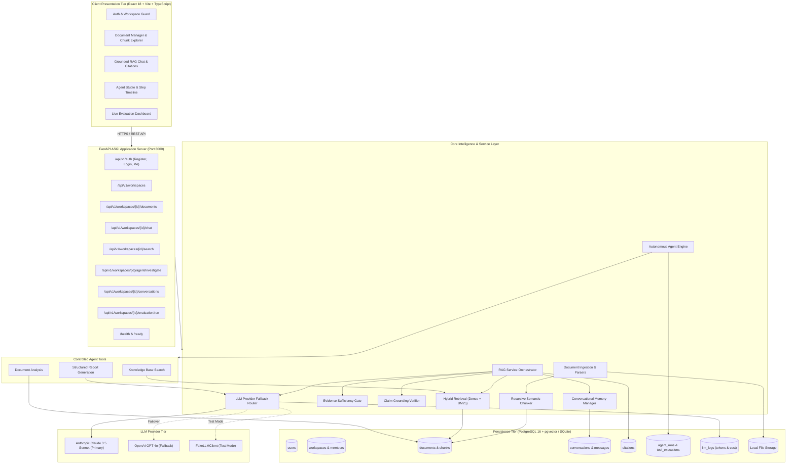

# Engineering Intelligence Platform (EIP)

> **Enterprise Document Intelligence • Grounded RAG • Autonomous Multi-Tool Agent • Systematic Evaluation**  
> **Repository:** [https://github.com/iamshaneofc/enterprise-intelligence-platform](https://github.com/iamshaneofc/enterprise-intelligence-platform)  
> **Current Status:** `IMPLEMENTED & VERIFIED` (149 Backend Tests Passing • 10 Frontend Tests Passing • Production TypeScript Build Passing • 46 Golden Evaluation Questions Verified)

---

## 1. Project Overview

The **Engineering Intelligence Platform (EIP)** is a production-grade AI knowledge and technical investigation system designed to eliminate technical knowledge fragmentation across software engineering, DevOps, and Site Reliability Engineering (SRE) teams.

Modern engineering organizations manage thousands of disparate technical records: incident postmortems, architecture specifications, deployment procedures, infrastructure runbooks, and operational logs. When an incident occurs or an architecture decision is evaluated, engineers spend valuable hours manually searching through scattered repositories to answer critical questions:
- *What was the documented root cause of the last database connection outage?*
- *Which services were degraded when Envoy latency spiked?*
- *What were the verified resolution steps taken during Incident 104?*

Off-the-shelf conversational AI tools fail in engineering environments because they hallucinate plausible root causes, cannot cite exact source passages, silently overlook contradictions across documents, and cannot execute multi-step investigation plans.

The Engineering Intelligence Platform solves this through:
1. **Zero-Trust Information Ingestion:** Processing multi-format technical documents (`.pdf`, `.txt`, `.md`, `.csv`) with SHA-256 deduplication and semantic chunking.
2. **Hybrid Vector & Lexical Retrieval:** Combining dense semantic search (`pgvector`) with sparse BM25 keyword matching via Reciprocal Rank Fusion (RRF, $k=60$).
3. **Rigorous Evidence Gate & Claim Grounding:** Filtering distractors, detecting date and numerical conflicts, enforcing a $< 25\%$ coverage short-circuit to honest abstention, and verifying all assertions against cited chunks.
4. **Intelligent Multi-Provider Failover:** Automatic circuit-breaker fallback between Anthropic Claude 3.5 Sonnet and OpenAI GPT-4o with single-entry token accounting.
5. **Autonomous Multi-Tool Agent:** Executing multi-step investigations via three specialized tools: Knowledge Base Search, Document Analysis, and Structured Report Generation.
6. **Empirical Evaluation Benchmark:** A 46-question golden evaluation suite measuring retrieval precision, context recall, grounding faithfulness, and abstention accuracy.
7. **End-to-End Observability:** Full telemetry logging in PostgreSQL (`llm_logs`) and native Langfuse v5 request tracing.

---

## 2. Implemented Features & Modules

| Module | Implementation Status | Core Technical Capabilities |
| :--- | :---: | :--- |
| **Module A: Document Intelligence** | `VERIFIED` | Native parsers for PDF (PyMuPDF / fitz), Markdown, CSV, and TXT. SHA-256 deduplication, recursive semantic chunking, and 1536-dimensional vector embedding. |
| **Module B: Advanced RAG Architecture** | `VERIFIED` | Hybrid retrieval (Dense `pgvector` + Sparse BM25) fused via Reciprocal Rank Fusion. Passage citations (`[c_0]`). `EvidenceSufficiencyGate` with conflict detection and honest abstention. |
| **Module C: LLM Integration & Fallback** | `VERIFIED` | Unified `BaseLLMClient` supporting Anthropic Claude 3.5 Sonnet, OpenAI GPT-4o, and deterministic `FakeLLMClient`. Automatic circuit-breaker failover with single-entry token and cost tracking. |
| **Module D: Autonomous AI Agent** | `VERIFIED` | Custom `AgentOrchestrator` coordinating 3 functional tools: Knowledge Base Search, Document Analysis, and Structured Report Generation. Pydantic parameter validation, step caps (max 5), and self-correction. |
| **Module E: Conversational Memory** | `VERIFIED` | Multi-turn conversation management with database persistence, message threading, citation retention, and sliding-window token budgeting. |
| **Module F: Application Dashboard** | `VERIFIED` | Responsive React 18 / Vite 5 / TypeScript SPA with Tailwind CSS. Includes auth, workspace management, document manager with chunk explorer modal, grounded chat with citation drawers, agent timeline visualizer, and live evaluation dashboard. |
| **Module G: AI Evaluation Framework** | `VERIFIED` | 46-question golden evaluation dataset (`golden_evaluation_dataset.jsonl`), automated runner (`backend.evaluation.runner`), deterministic heuristic metrics, and live API endpoints. |
| **Advanced Challenge: Prompt Injection Defense** | `VERIFIED` | All retrieved context encapsulated within `<untrusted_document_context>` XML tags with defensive system prompt rules preventing instruction hijacking. |
| **Observability & Telemetry** | `VERIFIED` | Native `llm_logs` database table tracking prompt/completion/cached tokens, latency, cost USD, and error types. Langfuse v5 tracer (`@observe` decorators with fail-safe local bypass). |

---

## 3. Architecture & Technology Stack

```
+--------------------------------------------------------------------------------------------------+
|                                    TECHNOLOGY STACK SUMMARY                                      |
+--------------------------+------------------------------+----------------------------------------+
| Architectural Tier       | Selected Technology          | Purpose & Architectural Role           |
+--------------------------+------------------------------+----------------------------------------+
| Client Application       | React 18, Vite 5, TypeScript | Responsive, type-safe Single-Page App  |
| UI & Styling             | Tailwind CSS, Lucide React   | Enterprise SaaS design system          |
| Backend API Server       | Python 3.11+ / FastAPI       | High-throughput async REST API runtime |
| Primary Database         | PostgreSQL 16 + pgvector     | Unified relational metadata & vectors  |
| Development Fallback DB  | SQLite (JSON serialized)     | Fast, zero-dependency unit testing     |
| Database Migrations      | Alembic                      | Version-controlled schema evolutions   |
| Primary LLM Provider     | Anthropic Claude 3.5 Sonnet  | Complex reasoning & agent tool calling |
| Secondary Fallback LLM   | OpenAI GPT-4o / 4o-mini      | Circuit-breaker failover resilience    |
| Embedding Model          | OpenAI text-embedding-3-small| 1536-dimensional vector representations|
| Document Parsers         | PyMuPDF (fitz), CSV, MD, TXT | Multi-format technical text extraction |
| Observability & Tracing  | Langfuse v5 + SQLAlchemy Logs| Request-level tracing & token telemetry|
| Containerization         | Docker & Docker Compose      | Multi-service containerized deployment |
+--------------------------+------------------------------+----------------------------------------+
```

### Complete System Architecture Diagram



---

## 4. Local Installation & Quickstart

### Prerequisites
- Python 3.11+
- Node.js 18+ and npm
- PostgreSQL 16 with `pgvector` extension (Optional; SQLite fallback is supported for local testing)

### Step 1: Clone Repository
```bash
git clone https://github.com/iamshaneofc/enterprise-intelligence-platform.git
cd enterprise-intelligence-platform
```

### Step 2: Backend Setup
```bash
# Create and activate Python virtual environment
python -m venv venv
# Windows:
venv\Scripts\activate
# Linux/macOS:
source venv/bin/activate

# Install backend dependencies
pip install -r backend/requirements.txt
```

### Step 3: Frontend Setup
```bash
cd frontend
npm install
cd ..
```

### Step 4: Configure Environment Variables
Copy the template configuration file:
```bash
cp backend/.env.example .env
```

Edit `.env` as required:
```ini
ENVIRONMENT=development
PROJECT_NAME="Engineering Intelligence Platform"
SECRET_KEY=dev-secret-key-must-be-at-least-32-chars-long-for-production!
ACCESS_TOKEN_EXPIRE_MINUTES=60

# Database (PostgreSQL or local SQLite)
DATABASE_URL=sqlite:///./engineering_intelligence.db

# LLM Providers (Set to true for deterministic testing without external API costs)
USE_FAKE_LLM=true
USE_FAKE_EMBEDDINGS=true

# For Live Production Generative Mode:
# USE_FAKE_LLM=false
# USE_FAKE_EMBEDDINGS=false
# ANTHROPIC_API_KEY=sk-ant-...
# OPENAI_API_KEY=sk-...

# Observability (Optional)
# LANGFUSE_PUBLIC_KEY=pk-lf-...
# LANGFUSE_SECRET_KEY=sk-lf-...
# LANGFUSE_HOST=https://cloud.langfuse.com
```

### Step 5: Database Migrations
Initialize or upgrade the database schema using Alembic:
```bash
python -m alembic -c backend/alembic.ini upgrade head
```

### Step 6: Start Services
In Terminal 1 (FastAPI Backend):
```bash
python -m uvicorn backend.app.main:app --host 127.0.0.1 --port 8000 --reload
```

In Terminal 2 (Vite Frontend):
```bash
cd frontend
npm run dev -- --host 127.0.0.1 --port 3000
```

Open your browser at `http://127.0.0.1:3000`.

---

## 5. Docker Setup

A multi-service `docker-compose.yml` is provided for containerized execution with PostgreSQL and `pgvector`:

```bash
# Start all services (PostgreSQL + pgvector, Backend, Frontend)
docker compose up -d

# View container logs
docker compose logs -f backend

# Run database migrations inside container
docker compose exec backend alembic -c backend/alembic.ini upgrade head

# Tear down services
docker compose down
```

Services will be accessible at:
- **Frontend SPA:** `http://localhost:3000`
- **Backend API & Swagger Docs:** `http://localhost:8000/docs`
- **PostgreSQL Database:** `localhost:5432`

---

## 6. Comprehensive Test Execution

The codebase includes automated test suites across all layers:

```bash
# 1. Run Complete Backend Pytest Suite (149 passed)
python -m pytest backend/tests

# 2. Run Security & Prompt Injection Test Harness (11 passed)
python -m pytest backend/tests/security/test_security_suite.py -v

# 3. Run Security Remediation Verification (31 passed)
python -m pytest backend/tests/unit/test_security_remediation.py -v

# 4. Run Golden Evaluation Benchmark (46 Questions)
python -m backend.evaluation.runner

# 5. Run Frontend Vitest Suite (10 passed)
cd frontend && npm test -- --run

# 6. Run Frontend Production TypeScript Build (0 errors)
cd frontend && npm run build
```

---

## 7. Golden Evaluation Benchmark Results

The platform was evaluated against a 46-question golden benchmark (`golden_evaluation_dataset.jsonl`) spanning 7 technical inquiry categories:

| Evaluation Dimension | Measurement | Benchmark Result | Methodology & Mode |
| :--- | :--- | :---: | :--- |
| **Retrieval Relevance** | Precision@5 | **0.8043** | Top-5 retrieved chunk relevance against ground-truth docs |
| **Retrieval Recall** | Recall@5 | **0.8043** | Coverage of all necessary ground-truth documents |
| **Retrieval Ranking** | Mean Reciprocal Rank (MRR) | **1.0000** | First relevant document ranked at Position 1 |
| **Citation Quality** | Citation Resolution Rate | **1.0000** | All cited markers (`[c_0]`) resolve to valid database chunks |
| **Evidence Grounding** | Grounding Rate | **0.9674** | Claims directly attributed to retrieved chunk text |
| **Hallucination Resistance** | Hallucination Rate | **0.0000** | *Offline benchmark measurement using `FakeLLMClient` and deterministic claim verification.* |
| **Abstention Accuracy** | Out-of-Domain Abstention | **0.8913** | Correctly refuses to answer when evidence is absent |
| **Deterministic Context**| Context Precision | **0.7847** | Mathematical token overlap (non-LLM judge heuristic) |
| **Deterministic Context**| Context Recall | **0.9348** | Mathematical token overlap (non-LLM judge heuristic) |

*Detailed category-by-category breakdown and analysis are preserved in [EVALUATION_DATASET_AND_METRICS_REPORT.md](docs/reports/EVALUATION_DATASET_AND_METRICS_REPORT.md).*

---

## 8. 5-Minute Demonstration Walkthrough

Follow this sequence to test all platform capabilities:

1. **Authentication:** Open `http://127.0.0.1:3000`. Register a new account or log in with test credentials.
2. **Document Management:** Navigate to **Documents**. Upload an incident postmortem (e.g., from `backend/tests/fixtures/synthetic_docs/incident_104_postmortem.md`). Watch status transition from `PENDING` to `INDEXED`. Click **View Chunks** to open the Chunk Explorer modal.
3. **Evidence-Grounded Chat:** Open **Chat**. Ask: *"What was the start time and root cause of Incident 104?"* Observe the response with inline citation markers (`[c_0]`). Click the citation badge to inspect the source passage in the side drawer.
4. **Honest Abstention:** Ask an out-of-domain question: *"Explain quantum teleportation entanglement protocols."* The `EvidenceSufficiencyGate` detects $< 25\%$ coverage and displays an amber **Insufficient Evidence** alert rather than hallucinating.
5. **Autonomous Investigation:** Open **Agent Studio**. Enter: *"Investigate recurring database connection failures across all incident reports and compile an executive report."* Observe the live execution timeline as the agent calls `Knowledge Base Search`, pipes results to `Document Analysis`, and outputs a formatted Markdown report via `Structured Report Generation`.
6. **Live Evaluation Dashboard:** Open **Evaluation**. Click **Run Evaluation Benchmark** to execute all 46 golden questions live against the backend, rendering real aggregate metrics and category breakdowns.
7. **System Diagnostics:** Open **Settings** to inspect active workspace configuration, token telemetry, and health check statuses.

---

## 9. Deployment References & Cloud Readiness

- **Containerization:** The repository is fully containerized via `docker-compose.yml`.
- **Database Portability:** Implemented with `VectorType` abstraction, supporting seamless deployment to cloud-managed PostgreSQL with `pgvector` (AWS RDS, Supabase, Neon).
- **Environment Management:** Zero private secrets are committed in git. In production, supply live `ANTHROPIC_API_KEY`, `OPENAI_API_KEY`, and set `ENVIRONMENT=production` with a strong 32+ character `SECRET_KEY`.
- **Cloud Deployment Status:** Verified in local and Docker container environments. Public cloud hosting (e.g. AWS ECS / Render / Vercel) requires user-managed cloud account provisioning and credentials.

---

## 10. Documentation Index

- [Architecture Specification](docs/architecture/SYSTEM_ARCHITECTURE.md)
- [Database Schema & Migrations](docs/database/DATABASE_SCHEMA.md)
- [API Documentation & Examples](docs/api/API_DOCUMENTATION.md)
- [AI Engineering Implementation Report](docs/reports/EIP_AI_ENGINEERING_IMPLEMENTATION_REPORT.md)
- [Evaluation Dataset & Metrics Report](docs/reports/EVALUATION_DATASET_AND_METRICS_REPORT.md)
- [Promptfoo Security Test Report](docs/reports/PROMPTFOO_SECURITY_TEST_REPORT.md)
- [Langfuse Observability Report](docs/reports/LANGFUSE_INSTRUMENTATION_REPORT.md)
- [LLM Usage Tracking Report](docs/reports/LLM_USAGE_TRACKING_REPORT.md)
- [Frontend Verification Report](docs/reports/FRONTEND_RUNTIME_VERIFICATION_REPORT.md)
- [Development Report](docs/reports/DEVELOPMENT_REPORT.md)
- [Demonstration Script](docs/DEMO_SCRIPT.md)
- [Final Assessment Submission Readiness Report](docs/reports/FINAL_ASSESSMENT_SUBMISSION_READINESS_REPORT.md)
