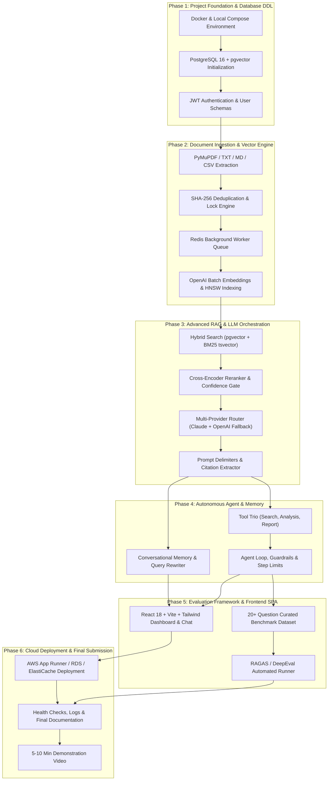

# Implementation Roadmap & Engineering Plan
## Engineering Intelligence Platform
**Document Type:** Phased Implementation Specification  
**Version:** 1.0  
**Phase:** Step 2 — Architecture & Implementation Planning  
**Status:** Approved for Implementation Execution  

---

## 1. Overview & Phasing Strategy

The **Engineering Intelligence Platform** implementation is broken into **six sequential phases**. The plan is structured to de-risk high-complexity AI components early (embeddings, hybrid search, multi-provider fallback) before building dependent layers (agent tools, conversational memory, frontend views).

### Core Engineering Principles for Implementation
1. **Vertical Slicing over Horizontal Stacking:** Build functional data paths end-to-end (e.g., Ingestion -> Vector -> Hybrid Search) before adding UI polish.
2. **Early Integration Verification:** External AI provider fallbacks, pgvector index performance, and file parsers are tested immediately upon scaffolding.
3. **No Mocks in Core Evaluation Pipelines:** As mandated by assessment Rule 6 (No Fabricated Functionality), all components run genuine algorithms and live API calls.
4. **Live Verification Readiness:** Maintain clean code structure so that any of the six live technical verification scenarios can be modified and demonstrated live during the 60-minute evaluation.

---

## 2. Implementation Dependency Graph



---

## 3. Phase-by-Phase Execution Plan

### Phase 1: Project Foundation & Database DDL
- **Scope:**
  - Multi-service `docker-compose.yml` (FastAPI backend, PostgreSQL 16 with `pgvector`, Redis 7).
  - SQLAlchemy 2.0 ORM models and Alembic migration scripts.
  - User registration, password hashing (bcrypt), and JWT authentication routes (`/api/v1/auth/login`, `/api/v1/auth/register`).
  - Base configuration, environment variable validation via Pydantic Settings, and CORS middleware.
- **Dependencies:** None. First phase.
- **Critical-Path Components:** `pgvector` extension activation (`CREATE EXTENSION IF NOT EXISTS vector;`).
- **Testing Requirements:**
  - Unit tests for password hashing and JWT encoding/decoding.
  - Integration test for database connection pool and vector table creation.

### Phase 2: Document Ingestion & Vector Engine
- **Scope:**
  - File upload endpoint `POST /api/v1/documents` accepting `.pdf`, `.txt`, `.md`, and `.csv`.
  - Format-specific parsers: PyMuPDF for PDF layout text, CSV row normalizer, Markdown AST parser.
  - Cryptographic deduplication (SHA-256) and Redis distributed lock to block duplicate jobs.
  - Recursive token chunker (512 tokens, 15% overlap) preserving header and page metadata.
  - Redis task queue and async worker for offloading heavy extraction and vector generation.
  - Batch embedding generation via OpenAI `text-embedding-3-small` and HNSW upsert into PostgreSQL.
  - Document status polling endpoint `GET /api/v1/documents/{id}/status`.
- **Dependencies:** Phase 1 (Database and Redis ready).
- **Independent Modules:** Parsers can be unit-tested completely independently with static sample files.
- **Testing Requirements:**
  - Unit tests for each file parser (PDF tables, Markdown headers, CSV key-value pairs).
  - Ingestion deduplication test: uploading the identical file twice must reject or return existing document.
  - Concurrency test: verifying Redis lock blocks parallel processing of the same file.

### Phase 3: Advanced RAG & LLM Orchestration
- **Scope:**
  - Multi-provider client abstraction (`BaseLLMClient`, `AnthropicClient` for Claude 3.5 Sonnet, `OpenAIClient` for GPT-4o).
  - Intelligent Fallback Router: intercepting HTTP 429, 5xx, or timeouts to failover between Claude and OpenAI.
  - Token and cost tracking logger writing to `llm_usage_logs`.
  - Two-stage hybrid search engine: dense vector cosine similarity + sparse PostgreSQL `tsvector` GIN keyword search merged via Reciprocal Rank Fusion (RRF).
  - Cross-encoder reranking filter with confidence threshold gate ($\tau \ge 0.65$).
  - Prompt construction with XML untrusted document delimiters (`<untrusted_document_context>`).
  - Citation mapping and grounding validator.
- **Dependencies:** Phase 2 (Indexed document chunks in pgvector).
- **Early Integration Gate:** Mock HTTP 429 error on Anthropic client to verify automatic failover to OpenAI with zero client disruption.
- **Testing Requirements:**
  - Provider fallback integration test verifying circuit breaker triggers on simulated downtime.
  - Retrieval accuracy test verifying hybrid search retrieves error codes that pure vector search misses.
  - Negative guardrail test: querying an un-indexed topic must trigger "insufficient evidence" refusal.

### Phase 4: Autonomous Agent & Conversational Memory
- **Scope:**
  - Conversational memory engine: sliding window (last 4 turns) + Claude 3 Haiku background summarizer.
  - Query rewriter: coreference resolution resolving pronouns into standalone search queries.
  - Tool 1 (`knowledge_base_search`): semantic vector and metadata search.
  - Tool 2 (`document_analysis`): deep inspection of specific documents (events, root causes, symptoms, mitigations).
  - Tool 3 (`structured_report_generation`): executive markdown report compiler.
  - Custom agent loop: reasoning loop, Pydantic tool argument validation, max 5-step cap, 30s timeouts, and self-correction error feedback.
- **Dependencies:** Phase 3 (RAG and LLM Router operational).
- **Testing Requirements:**
  - Multi-step chaining test: verify Tool 1 output (search results) successfully passes into Tool 2 (analysis), which feeds Tool 3 (report).
  - Agent reliability test: simulate invalid tool arguments to verify agent self-corrects via error feedback.
  - Memory test: verify follow-up question ("How was it resolved?") correctly resolves the antecedent from the previous turn.

### Phase 5: Evaluation Framework & Frontend Dashboard
- **Scope:**
  - 20+ question curated benchmark dataset (`docs/evaluation/benchmark_dataset.json`) covering direct extraction, multi-doc synthesis, contradictions, and negative tests.
  - Automated evaluation runner script (`scripts/run_evaluation.py`) using RAGAS for quantitative scoring (Precision, Recall, Faithfulness, Relevance, Latency, Token Cost).
  - React 18 + Vite + Tailwind Single-Page Application:
    - User authentication and protected route shells.
    - Document manager with drag-and-drop upload, status badges, and deletion.
    - Grounded chat workspace with streaming SSE tokens and interactive citation side-drawer.
    - Agent studio showing live step-by-step tool invocation cards and parameter inputs.
    - Analytics dashboard visualizing token burn by model, latency distributions, and system error logs.
- **Dependencies:** Phases 1–4 (All backend endpoints active).
- **Testing Requirements:**
  - End-to-end evaluation benchmark run with complete report generation.
  - Frontend responsiveness and citation click-through verification across desktop and mobile viewports.

### Phase 6: Cloud Deployment & Final Deliverables
- **Scope:**
  - Production multi-stage Dockerfiles for backend and frontend.
  - Cloud infrastructure provisioning (AWS App Runner / ECS Fargate, RDS PostgreSQL 16 with `pgvector`, Redis Cloud / ElastiCache, S3).
  - Automated environment variable configuration and SSL certification.
  - System health verification (`/health` and `/ready` endpoints).
  - Final documentation compilation (`docs/reports/development_report.md`, `CLAUDE.md`, updated `README.md`).
  - 5–10 minute video demonstration recording walkthrough.
- **Dependencies:** Phase 5 (Complete application and evaluation verified).
- **Testing Requirements:**
  - Public cloud smoke testing: execute live document upload, RAG query with citations, and multi-step agent investigation on live URLs.

---

## 4. Critical-Path Analysis & Bottleneck Management

```
Critical Path:
Phase 1 (PostgreSQL + pgvector DDL)
    │
    ▼
Phase 2 (PyMuPDF Extraction & Batch Embeddings)
    │
    ▼
Phase 3 (Hybrid Search & LLM Fallback Router)
    │
    ▼
Phase 4 (Agent Tool Chaining)
    │
    ▼
Phase 5 (20+ Question Evaluation Benchmark)
    │
    ▼
Phase 6 (Live Cloud Deployment & Video Walkthrough)
```

### Bottleneck Mitigation
1. **API Rate Limits during Batch Embedding:** Mitigated by implementing client-side batching (64 chunks per batch) with exponential backoff.
2. **LLM Provider Outages during Development:** The dual-provider architecture guarantees that if Anthropic API is degraded, development proceeds unimpeded via OpenAI GPT-4o.
3. **Cloud Provisioning Delays:** Local Docker Compose topology mirrors cloud containers identically; deployment involves deploying pre-tested containers rather than building infrastructure from scratch.

---

## 5. Technical Risks & Mitigation Registry

| # | Identified Technical Risk | Severity | Probability | Mitigation Strategy in Architecture |
| :-: | :--- | :---: | :---: | :--- |
| **R1** | Ingress reverse proxy timeouts on large PDF uploads. | HIGH | MEDIUM | Asynchronous processing via Redis queue; API returns `202 Accepted` in <100ms. |
| **R2** | Primary LLM provider rate limit (HTTP 429) during live verification. | HIGH | MEDIUM | Circuit breaker in `LLMFallbackRouter` immediately fails over to OpenAI GPT-4o. |
| **R3** | Adversarial prompt injection inside uploaded PDF manuals. | HIGH | LOW | Untrusted XML context delimitation (`<untrusted_document_context>`) and zero-instruction system prompt. |
| **R4** | Agent gets trapped in an infinite reasoning or tool loop. | MEDIUM | MEDIUM | Strict 5-iteration step limit and 30-second per-tool timeout; forced clean termination. |
| **R5** | Pure vector search missing exact alphanumeric error codes. | MEDIUM | HIGH | Hybrid retrieval combining pgvector dense cosine search with PostgreSQL BM25 `tsvector` via RRF. |
| **R6** | Cloud deployment failure or configuration drift before submission. | HIGH | LOW | Multi-stage Docker containers tested locally in Docker Compose before cloud deployment. |

---

## 6. Live Technical Verification Readiness Checklist

Shortlisted candidates undergo a **60-minute supervised live evaluation** over screen share. Reviewers will introduce an unexpected requirement from the six scenarios below. The codebase is pre-architected to accommodate each:

| Scenario # | Potential Live Challenge | Architectural Preparation in Codebase | Est. Time to Modify Live |
| :---: | :--- | :--- | :---: |
| **1** | Introduce a secondary LLM provider and implement automatic fallback. | Already implemented via `BaseLLMClient` and `LLMFallbackRouter`. Candidate can easily demonstrate provider failover or swap in Gemini/Ollama in ~15 mins. | 10–15 mins |
| **2** | Modify RAG pipeline to handle conflicting information from two documents. | Prompt template in `app/rag/prompt_templates.py` includes a dedicated conflict-detection block that can be modified directly. | 10–15 mins |
| **3** | Implement a new tool in the existing agent architecture. | Modular `BaseTool` class in `app/agents/tools/`. Candidate writes a single subclass, defines Pydantic input schema, and calls `registry.register()`. | 10–15 mins |
| **4** | Prevent duplicate document-processing jobs. | Distributed Redis lock (`doc_lock:{hash}`) and SHA-256 database constraint in `app/services/document_service.py`. | 10–15 mins |
| **5** | Fix unsupported answers when retrieval returns irrelevant documents. | Calibrated confidence gate in `app/retrieval/reranker.py` with score threshold $\tau$. Easily adjusted in one config line. | 5–10 mins |
| **6** | Identify and fix a security vulnerability in an existing API. | FastAPI dependency injection, strict Pydantic schemas, and parameterized SQLAlchemy queries ensure clean security auditing. | 10–15 mins |

