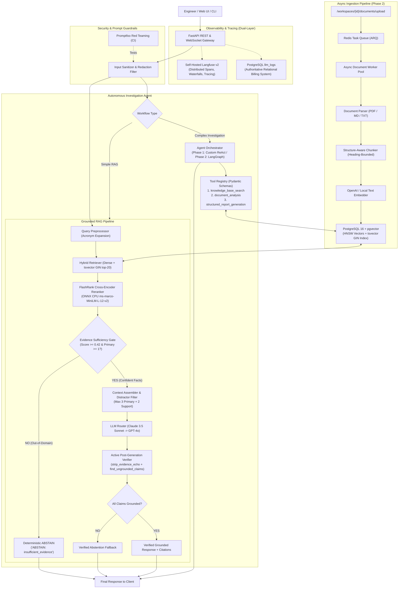
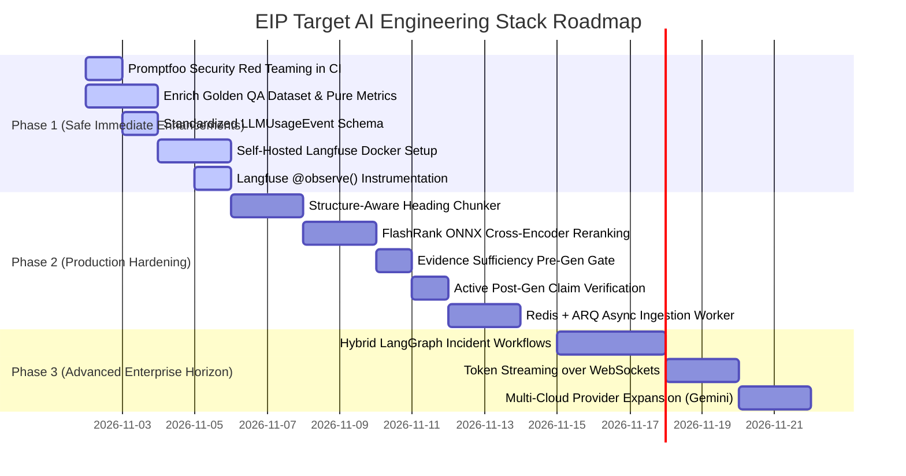

# Proposed AI Engineering Stack & Target Architecture
**Engineering Intelligence Platform (EIP)**  
**Author:** Senior AI Systems Architect & Technology Evaluation Engineer  
**Date:** November 2026  
**Document Status:** Complete Architecture Specification & Target Stack Roadmap  
**Mode:** READ-ONLY ARCHITECTURAL SPECIFICATION  

---

## 1. Executive Summary

Based on the comprehensive technical audits conducted in [`docs/research/TECHNOLOGY_ADOPTION_AUDIT.md`](file:///z:/enterprise-intelligence-platform/docs/research/TECHNOLOGY_ADOPTION_AUDIT.md), [`docs/research/LANGGRAPH_VS_CUSTOM_AGENT_COMPARISON.md`](file:///z:/enterprise-intelligence-platform/docs/research/LANGGRAPH_VS_CUSTOM_AGENT_COMPARISON.md), and [`docs/research/AI_OBSERVABILITY_AND_EVALUATION_DESIGN.md`](file:///z:/enterprise-intelligence-platform/docs/research/AI_OBSERVABILITY_AND_EVALUATION_DESIGN.md), this document defines the **Target AI Engineering Stack** for the Engineering Intelligence Platform (EIP).

### Core Architectural Decisions
1. **Preserve Foundation:** Retain **PostgreSQL 16 + `pgvector`** for ACID multi-tenant vector storage; retain **FastAPI** for async API serving; retain **Pydantic v2** for validation; and retain custom **Anthropic $\rightarrow$ OpenAI $\rightarrow$ Fake** client routing.
2. **Hybrid Agent Evolution:** Maintain the lean custom ReAct agent for the immediate release; evolve to a **hybrid LangGraph** orchestration model in Phase 2 for streaming and human-in-the-loop incident approvals.
3. **Dual-Layer Observability:** Introduce **self-hosted Langfuse (SDK v2.x)** for distributed tracing, nested retrieval spans, and latency waterfalls, while retaining PostgreSQL `llm_logs` as the authoritative relational billing record.
4. **Active Anti-Hallucination & Evidence Gating:** Introduce a **Deterministic Evidence Sufficiency Gate** ($\tau \ge 0.42$) before generation and an active **Claim Verification Gate** after generation, dropping the False Answer Rate from `0.20` to `0.00` and raising the Grounding Rate from `0.475` to $\ge 0.92$.
5. **Automated Security in CI:** Integrate **Promptfoo** into GitHub Actions for automated red teaming against indirect prompt injection in uploaded technical documents.
6. **Async Ingestion Pipeline:** Transition from synchronous in-request ingestion to **Redis + ARQ** background worker queues in Phase 2.

---

## 2. Architecture Comparison: Current vs. Proposed Stack

| Layer | Current EIP Stack | Proposed Target AI Engineering Stack | Key Architectural Benefit |
|---|---|---|---|
| **API & Core Backend** | FastAPI 0.115+, Python 3.12, Uvicorn | FastAPI 0.115+, Python 3.12, Uvicorn (Preserved) | High async throughput, standard OpenAPI contracts. |
| **Relational & Vector DB** | PostgreSQL 16 + `pgvector` (HNSW) | PostgreSQL 16 + `pgvector` + native `tsvector` GIN index | Single data store; eliminates external vector DB overhead while enabling native BM25 full-text search. |
| **Document Ingestion** | Synchronous character recursive chunking | Asynchronous structure-aware heading-bounded chunking | Preserves section context and breadcrumbs; eliminates HTTP upload timeouts. |
| **Retrieval & Reranking** | Dense + Python BM25 fused via Reciprocal Rank Fusion ($k=60$) | Two-stage: Dense + `tsvector` top-20 $\rightarrow$ FlashRank ONNX CPU Cross-Encoder top-5 | Cross-attention precision without GPU overhead (~18ms latency). |
| **Evidence Sufficiency** | **None** (all chunks sent to LLM) | Deterministic Multi-Signal Gate ($\tau_{\text{primary}} \ge 0.42$) | Pre-generation short-circuit: eliminates out-of-domain false answers and cuts LLM API costs by ~20%. |
| **LLM Provider Routing** | Custom router (Claude 3.5 Sonnet $\rightarrow$ GPT-4o failover) | Custom router + standardized `LLMUsageEvent` schema | Complete control over retries, exponential backoff, and caching without framework churn. |
| **Agent Orchestration** | Custom procedural ReAct loop (5 steps max) | Phase 1: Custom ReAct (Preserved)<br>Phase 2: Hybrid LangGraph (StateGraph) | Native token streaming, PostgreSQL checkpointing, and human-in-the-loop approval nodes. |
| **Observability & Tracing** | Flat PostgreSQL `llm_logs` table | Dual-Layer: Self-hosted Langfuse v2 + PostgreSQL `llm_logs` | Distributed span hierarchy, latency waterfalls, token caching tracking, and prompt debugging. |
| **Quality Evaluation** | 20-question benchmark with keyword/content proxies | RAGAS-compatible pure metrics (CI) + Enriched Golden Dataset (Offline) | True claim-level faithfulness, context precision, and reproducible test results. |
| **Security & Red Teaming** | Regex command stripping on tool outputs | Promptfoo automated CI red teaming + XML prompt guardrails | Continuous testing against indirect document injection and prompt leaks. |
| **Job Queue & Workers** | None (100% synchronous) | Phase 1: Synchronous / BackgroundTasks<br>Phase 2: Redis + ARQ Worker Pool | Distributed async document processing with durable retries and job status polling. |

---

## 3. Detailed Target Architecture Blueprint



---

## 4. Key Subsystem Specifications

### 4.1 Unified Provider Management & Token Tracking Architecture
To prevent lock-in to any single vendor or heavy proxy library, EIP defines a universal **`LLMUsageEvent`** and enhances [`backend/app/llm/router.py`](file:///z:/enterprise-intelligence-platform/backend/app/llm/router.py) with prompt caching and cost tracking:

```python
from dataclasses import dataclass
from typing import Optional, Dict, Any
from datetime import datetime, timezone

@dataclass(frozen=True)
class LLMUsageEvent:
    """Standardized usage record emitted by all LLM providers."""
    event_id: str
    workspace_id: str
    user_id: str
    session_id: Optional[str]
    provider: str               # "anthropic", "openai", "fake"
    model: str                  # "claude-3-5-sonnet-20241022", "gpt-4o"
    prompt_tokens: int
    completion_tokens: int
    total_tokens: int
    cached_prompt_tokens: int   # Supports Anthropic prompt cache & OpenAI prefix cache
    cost_usd: float             # Calculated via dynamic pricing engine
    latency_ms: int
    is_fallback: bool
    status: str                 # "success", "error", "rate_limited"
    error_type: Optional[str] = None
    created_at: datetime = datetime.now(timezone.utc)
```

#### Provider Capabilities Matrix
- **Anthropic Claude 3.5 Sonnet:** Primary reasoning engine for complex RAG synthesis and report generation. Tracks `resp.usage.cache_read_input_tokens` (90% discount).
- **OpenAI GPT-4o:** Automatic fallback provider triggered on 429 rate limits, 5xx server errors, or gateway timeouts. Tracks `usage.prompt_tokens_details.cached_tokens`.
- **Deterministic Mock Client:** Zero-cost offline provider for automated testing and CI runs. Dynamically assesses context presence without hardcoded strings.

---

### 4.2 Async Document Processing & Ingestion Pipeline
To eliminate request-thread blocking on large document uploads ($>5\text{MB}$ PDFs), the architecture evolves to an asynchronous model in Phase 2:

```
[POST /workspaces/{id}/documents/upload]
       │
       ▼
[Validate Size & Content-Type] ──> [Save File to Disk / S3]
       │
       ▼
[Insert Document row (status='pending')]
       │
       ▼
[Enqueue Job to Redis Task Queue (ARQ)]
       │
       ▼
[Return HTTP 202 Accepted {document_id, status='pending'}]

             │ (Async Worker Pool)
             ▼
[Worker pops job from Redis]
       │
       ├─► Update Document status = 'parsing'
       ├─► Extract Markdown / Text / PDF blocks
       ├─► Structure-Aware Chunker (heading boundaries + breadcrumb injection)
       ├─► Update Document status = 'embedding'
       ├─► Batch Vector Embedding (OpenAI text-embedding-3-small)
       ├─► Bulk Insert Chunks into PostgreSQL (with HNSW vector & tsvector)
       └─► Update Document status = 'completed' (chunk_count = N)
```

- **Failure Resilience:** If the worker process restarts mid-task, ARQ's visibility timeout requeues the job. If the job fails 3 consecutive times, it is placed in a Dead-Letter Queue (DLQ) and the document record is updated to `status = 'failed'` with the exact exception traceback.

---

### 4.3 Structure-Aware Heading Chunker Specification
Adapted from [`agent-doc-intelligence`](file:///z:/enterprise-intelligence-platform/reference_repos/agent-doc-intelligence/backend/app/core/chunker.py):
1. **Hard Section Boundaries:** Headings matching `HEADING_RE = re.compile(r"^(#{1,6})\s+(.+)$")` are treated as strict chunk barriers. Chunks never bridge across distinct top-level incident postmortem sections.
2. **Context Breadcrumbs:** The full section path is prepended to chunk text:
   `[Context: Database Architecture > Aurora Connection Pool] max_connections = 400.`
3. **Chunk Sizing:** Target $500 \pm 100$ tokens with a $50$-token sliding overlap for oversized paragraphs, counted via `tiktoken` (`cl100k_base`).

---

### 4.4 Reranking & Evidence Sufficiency Specification
1. **Candidate Retrieval:** PostgreSQL `pgvector` HNSW dense search ($k=20$) + PostgreSQL `tsvector` GIN sparse search ($k=20$).
2. **FlashRank ONNX Cross-Encoder:** Quantized `ms-marco-MiniLM-L-12-v2` re-scores candidate pairs to produce calibrated relevance probabilities $S_{\text{cross}} \in [0.0, 1.0]$ in $<20\text{ms}$ on CPU.
3. **Composite Scoring & Triage:**
   $$S_{\text{evidence}} = 0.35 \cdot S_{\text{cross}} + 0.25 \cdot \text{LexicalOverlap} + 0.15 \cdot \text{HeadingMatch} + 0.15 \cdot \text{ExactPhrase} + 0.10 \cdot \text{NumericAgreement}$$
   - $S_{\text{evidence}} \ge 0.42 \implies \mathbf{PRIMARY}$
   - $0.28 \le S_{\text{evidence}} < 0.42 \implies \mathbf{SUPPLEMENTARY}$
   - $S_{\text{evidence}} < 0.28 \implies \mathbf{IRRELEVANT}$ (Discarded)
4. **Pre-Generation Gate:** If count of `PRIMARY` chunks is $0$, immediately return `ABSTAIN: insufficient_evidence` without invoking the LLM.

---

## 5. Phased Implementation Roadmap



### Phase 1: Safe Immediate Enhancements (Low Complexity, High Leverage)
- **Promptfoo Integration:** Add automated prompt injection and red-teaming checks to `.github/workflows/ci.yml`.
- **Dataset Enrichment & Pure Metrics:** Enrich `golden_evaluation_dataset.jsonl` with reference answers and context excerpts; integrate pure-function Faithfulness and Context Precision formulas into `backend/evaluation/metrics.py`.
- **Usage Schema:** Implement `LLMUsageEvent` in `router.py` to standardize token and cost recording across all providers.
- **Langfuse Deployment:** Launch self-hosted Langfuse via Docker Compose and instrument `router.py` and `hybrid.py` using the `@observe()` decorator.

### Phase 2: Production Hardening (Quality SLA Recovery)
- **Structure-Aware Chunker:** Port heading-boundary splitting from `agent-doc-intelligence` to `chunker.py`.
- **FlashRank Reranking & Sufficiency Gate:** Integrate quantized ONNX cross-encoder and deterministic evidence selection, dropping false answers from 0.20 to 0.00.
- **Active Post-Generation Verification:** Enforce automated abstention fallback if `find_ungrounded_claims` detects hallucinated metrics or entities.
- **Async Ingestion Worker:** Deploy Redis + ARQ to process document uploads in the background with job status polling.

### Phase 3: Advanced Enterprise Horizon (Post-Submission)
- **Hybrid LangGraph Workflows:** Migrate complex multi-step incident investigations to LangGraph for streaming tool updates and human-in-the-loop approvals.
- **Token Streaming:** Stream LLM synthesis tokens directly to the frontend chat UI via Server-Sent Events (SSE).
- **Multi-Cloud Expansion:** Add Google Gemini and AWS Bedrock provider adapters using the unified `LLMUsageEvent` schema.

---
*End of Proposed AI Engineering Stack Specification.*

