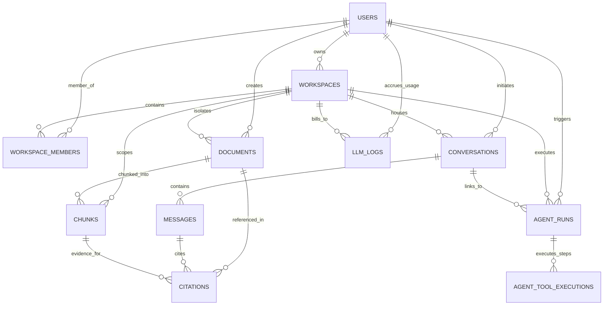
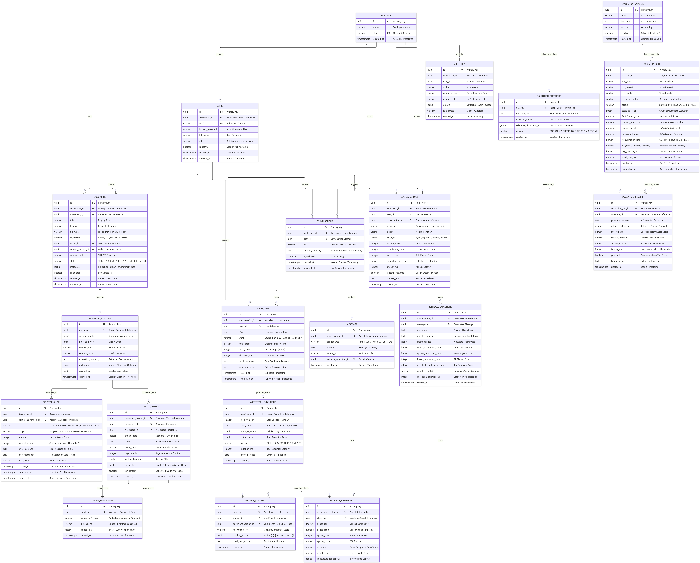

# Physical Database Schema Specification
## Engineering Intelligence Platform
**Document Type:** Physical Database Design & DDL Specification  
**Version:** 1.0  
**Target Engine:** PostgreSQL 16 + `pgvector` 0.7+  
**Phase:** Step 3 — Database Schema Design  
**Author:** Principal Database Architect  
**Status:** Approved for Implementation  

---

## Table of Contents
1. [Active Production Schema & Alembic Migration Guide (Current Working State)](#1-active-production-schema--alembic-migration-guide)
   - [1.1 Active Tables Specification](#11-active-tables-specification)
   - [1.2 Entity Relationships & Diagram](#12-entity-relationships--diagram)
   - [1.3 Multi-Tenant Workspace Isolation](#13-multi-tenant-workspace-isolation)
   - [1.4 Document & Chunk Integrity](#14-document--chunk-integrity)
   - [1.5 Conversations, Messages & Citation Linkages](#15-conversations-messages--citation-linkages)
   - [1.6 LLM Usage & Cost Telemetry (`llm_logs`)](#16-llm-usage--cost-telemetry-llm_logs)
   - [1.7 Evaluation Benchmark Records](#17-evaluation-benchmark-records)
   - [1.8 Alembic Migration Workflow & CLI Reference](#18-alembic-migration-workflow--cli-reference)
2. [Target Enterprise Schema Specification](#2-target-enterprise-schema-specification)
3. [Physical ERD Reference](#3-physical-erd-reference)
4. [Table-by-Table Schema Specifications (Enterprise Blueprint)](#4-table-by-table-schema-specifications)
5. [Vector Storage & pgvector Indexing Design](#5-vector-storage--pgvector-indexing-design)
6. [Hybrid Full-Text Search Indexing (BM25 Equivalent)](#6-hybrid-full-text-search-indexing-bm25-equivalent)
7. [Data Integrity, Foreign Keys & Cascading Rules](#7-data-integrity-foreign-keys--cascading-rules)
8. [Query Patterns & Index Justification Matrix](#8-query-patterns--index-justification-matrix)
9. [Data Lifecycle, Retention & Cleanup Procedures](#9-data-lifecycle-retention--cleanup-procedures)
10. [Row-Level Security (RLS) Policy Specifications](#10-row-level-security-rls-policy-specifications)

---

## 1. Active Production Schema & Alembic Migration Guide

This section documents the **actual active database schema** currently implemented, tested, and migrated across the Engineering Intelligence Platform codebase.

### 1.1 Active Tables Specification

The active database model is composed of **11 normalized tables** defined in Python via SQLModel / SQLAlchemy (`backend/app/models/`) and version-controlled via Alembic:

| Table Name | Model Class | Primary Key | Foreign Keys & Cascades | Purpose |
| :--- | :--- | :--- | :--- | :--- |
| `users` | `User` | `id` (VARCHAR 36) | None | System user identities, bcrypt passwords, and global roles (`admin`, `engineer`, `viewer`). |
| `workspaces` | `Workspace` | `id` (VARCHAR 36) | `owner_id` -> `users(id)` ON DELETE CASCADE | Multi-tenant tenant boundary; isolates all knowledge, sessions, and telemetry. |
| `workspace_members`| `WorkspaceMember`| `id` (VARCHAR 36) | `workspace_id` -> `workspaces(id)` ON DELETE CASCADE<br/>`user_id` -> `users(id)` ON DELETE CASCADE | Role-based membership linking users to workspaces (`admin`, `member`, `viewer`). |
| `documents` | `Document` | `id` (VARCHAR 36) | `workspace_id` -> `workspaces(id)` ON DELETE CASCADE<br/>`created_by` -> `users(id)` ON DELETE SET NULL | Master document catalog with SHA-256 hash, lifecycle status, and JSON metadata. |
| `chunks` | `Chunk` | `id` (VARCHAR 36) | `document_id` -> `documents(id)` ON DELETE CASCADE<br/>`workspace_id` -> `workspaces(id)` ON DELETE CASCADE | Semantic text chunks with 1536-dimensional vector embeddings (`pgvector`). |
| `conversations` | `Conversation` | `id` (VARCHAR 36) | `workspace_id` -> `workspaces(id)` ON DELETE CASCADE<br/>`user_id` -> `users(id)` ON DELETE CASCADE | Multi-turn conversational investigation sessions with sliding summaries. |
| `messages` | `Message` | `id` (VARCHAR 36) | `conversation_id` -> `conversations(id)` ON DELETE CASCADE | Turn-by-turn chat history (`user`, `assistant`, `system`) with token estimates. |
| `citations` | `Citation` | `id` (VARCHAR 36) | `message_id` -> `messages(id)` ON DELETE CASCADE<br/>`chunk_id` -> `chunks(id)` ON DELETE CASCADE | Precise passage citations (`[c_0]`) linking assistant messages to chunks and docs. |
| `agent_runs` | `AgentRun` | `id` (VARCHAR 36) | `workspace_id` -> `workspaces(id)` ON DELETE CASCADE<br/>`user_id` -> `users(id)` ON DELETE CASCADE<br/>`conversation_id` -> `conversations(id)` ON DELETE SET NULL | Autonomous agent investigation executions with task plan and final markdown report. |
| `agent_tool_executions`| `AgentToolExecution`| `id` (VARCHAR 36)| `agent_run_id` -> `agent_runs(id)` ON DELETE CASCADE | Step-by-step tool execution audit trail (Search, Analyze, Report) with inputs/outputs. |
| `llm_logs` | `LLMLog` | `id` (VARCHAR 36) | None (Indexes on `workspace_id`, `user_id`, `session_id`) | Financial, token, and performance telemetry for every completed LLM generation. |

---

### 1.2 Entity Relationships & Diagram

The physical entity relationships enforce strict referential integrity and tenant boundaries:



---

### 1.3 Multi-Tenant Workspace Isolation

Multi-tenancy is enforced at both the database and application levels:
1. **Foreign Key Scoping:** Every data record (`documents`, `chunks`, `conversations`, `agent_runs`, `llm_logs`) includes an indexed `workspace_id` column.
2. **Access Control Verification:** The API dependency `verify_workspace_access(workspace_id, current_user, db)` in [`backend/app/api/dependencies.py`](file:///z:/enterprise-intelligence-platform/backend/app/api/dependencies.py) checks that the requesting user is either the workspace owner or has an active membership record in `workspace_members`.
3. **Query Boundary Enforcement:** All SQL queries (relational lookups, BM25 searches, and `pgvector` cosine similarity searches) include explicit `workspace_id = :workspace_id` WHERE clauses. A user from Workspace A cannot retrieve or vector-match documents from Workspace B.

---

### 1.4 Document & Chunk Integrity

1. **Cryptographic Deduplication:** Before storing a file, `DocumentService` computes its SHA-256 hash. If `file_hash` already exists in `documents` for the same `workspace_id`, the upload is rejected or linked to avoid duplicate chunking and token waste.
2. **Parent-Child Cascading:** `chunks.document_id` references `documents.id` with `ON DELETE CASCADE`. When an engineering document is deleted, all extracted chunks and associated vector embeddings are atomically purged.
3. **Vector Type Support:** The `chunks.embedding` column uses a custom SQLAlchemy `VectorType(1536)` in [`backend/app/db/types.py`](file:///z:/enterprise-intelligence-platform/backend/app/db/types.py). On PostgreSQL, it maps directly to `pgvector` with HNSW indexing; on SQLite (used for local fast unit testing), it serializes to JSON text.

---

### 1.5 Conversations, Messages & Citation Linkages

1. **Hierarchical Cascading:** Deleting a `conversation` automatically deletes all its child `messages` and all associated `citations`.
2. **Citation Markers:** When the RAG engine generates an answer, inline citation markers (e.g. `[c_0]`, `[c_1]`) are resolved into `citations` rows:
   - `message_id`: Assistant message containing the assertion.
   - `chunk_id`: The exact chunk in `chunks` supporting the assertion.
   - `document_id`: The source document.
   - `score`: Dense/sparse hybrid relevance score.
   - `snippet`: Verbatim chunk excerpt for click-to-verify side drawers.

---

### 1.6 LLM Usage & Cost Telemetry (`llm_logs`)

The `llm_logs` table provides complete operational auditability for all generative calls:

| Column Name | SQL Type | Description |
| :--- | :--- | :--- |
| `id` | VARCHAR(36) PK | Unique log event identifier (UUID). |
| `workspace_id` | VARCHAR(36) INDEX | Workspace tenant responsible for token cost. |
| `user_id` | VARCHAR(36) INDEX | User initiating the generation. |
| `session_id` | VARCHAR(36) INDEX | Associated conversation ID (added in revision `58f1a23b49de`). |
| `provider` | VARCHAR(50) | Provider name (`anthropic`, `openai`, `fake`). |
| `model` | VARCHAR(100) | Specific model invoked (`claude-3-5-sonnet-20241022`, `gpt-4o`). |
| `prompt_tokens` | INTEGER | Prompt input token count. |
| `completion_tokens` | INTEGER | Generated response token count. |
| `total_tokens` | INTEGER | Sum of prompt and completion tokens. |
| `cached_prompt_tokens` | INTEGER | Prompt tokens served from cache (added in revision `58f1a23b49de`). |
| `latency_ms` | INTEGER | Wall-clock request latency in milliseconds. |
| `cost_usd` | FLOAT | Calculated cost in USD based on provider model pricing. |
| `is_fallback` | BOOLEAN | True if the circuit breaker fell back to secondary provider. |
| `status` | VARCHAR(50) | Execution outcome (`success` or `error`). |
| `error_type` | VARCHAR(100) | Error category if failed (e.g. `RateLimitError`). |
| `created_at` | DATETIME | Timestamp of invocation. |

> [!IMPORTANT]
> **Single-Entry Accounting Principle:** The router logs exactly 1 record per completed user request with `is_fallback=True` if failover occurred. It does not insert multiple billing rows for retried attempts, preventing artificial cost inflation.

---

### 1.7 Evaluation Benchmark Records

Evaluation records operate across two integrated layers:
1. **Golden Benchmark Dataset:** Maintained at [`backend/tests/fixtures/golden_evaluation_dataset.jsonl`](file:///z:/enterprise-intelligence-platform/backend/tests/fixtures/golden_evaluation_dataset.jsonl), containing 46 curated engineering questions spanning 7 technical categories.
2. **Evaluation Execution & Telemetry:** Executed by `backend.evaluation.runner` and exposed via API endpoints (`POST /api/v1/workspaces/{workspace_id}/evaluation/run` and `GET /results`). Computes deterministic heuristic context precision, recall, grounding rates, and offline hallucination rates.

---

### 1.8 Alembic Migration Workflow & CLI Reference

All schema modifications are tracked through Alembic revisions in `backend/alembic/versions/`.

#### Active Revision History Graph:
```
47e95deb65dd (initial_migration: 10 base tables + pgvector check)
      │
      ▼
260ef031ac96 (add_pgvector_extension_and_index: HNSW cosine index on chunks.embedding)
      │
      ▼
58f1a23b49de (head: add_llm_log_telemetry_columns - session_id, cached_prompt_tokens, error_type)
```

#### Step-by-Step CLI Commands:

1. **Inspect Migration Status & Head:**
   ```bash
   python -m alembic -c backend/alembic.ini current
   python -m alembic -c backend/alembic.ini heads
   ```

2. **Upgrade Database to Head Revision:**
   ```bash
   python -m alembic -c backend/alembic.ini upgrade head
   ```

3. **Roll Back Previous Migration:**
   ```bash
   python -m alembic -c backend/alembic.ini downgrade -1
   ```

4. **Generate New Migration Revision:**
   ```bash
   python -m alembic -c backend/alembic.ini revision --autogenerate -m "add_new_feature_table"
   ```

---

The **Engineering Intelligence Platform** physical schema is designed for **PostgreSQL 16** with the **`pgvector`** extension. It unifies relational ACID consistency, immutable document snapshots, high-dimensional vector search, and full-text lexical indexing in a single, highly normalized database cluster.

### PostgreSQL Extensions Required
```sql
-- Core extensions required for UUID generation, vector math, and full-text trigrams
CREATE EXTENSION IF NOT EXISTS "uuid-ossp";
CREATE EXTENSION IF NOT EXISTS "pgcrypto";
CREATE EXTENSION IF NOT EXISTS "vector";
CREATE EXTENSION IF NOT EXISTS "pg_trgm";
```

---

## 2. Physical ERD Reference


*Figure 2.1: Complete Physical Entity Relationship Diagram (Editable source: `docs/database/ERD.mmd`).*

---

## 3. Table-by-Table Schema Specifications

### 3.1 Identity & Access Management Tables

#### Table 1: `workspaces`
Represents the top-level tenant boundary. All documents, conversations, and usage records are scoped to a workspace.

| Column | Data Type | Nullable | Default | Constraints & Description |
| :--- | :--- | :---: | :---: | :--- |
| `id` | UUID | NO | `gen_random_uuid()` | **PRIMARY KEY** |
| `name` | VARCHAR(100) | NO | - | Display name of the engineering organization/team |
| `slug` | VARCHAR(100) | NO | - | **UNIQUE**, lowercase URL-safe slug |
| `created_at` | TIMESTAMPTZ | NO | `NOW()` | Creation timestamp |

```sql
CREATE TABLE workspaces (
    id UUID PRIMARY KEY DEFAULT gen_random_uuid(),
    name VARCHAR(100) NOT NULL,
    slug VARCHAR(100) UNIQUE NOT NULL,
    created_at TIMESTAMPTZ NOT NULL DEFAULT NOW()
);
CREATE INDEX idx_workspaces_slug ON workspaces(slug);
```

#### Table 2: `users`
Represents authenticated engineers, operators, and administrators.

| Column | Data Type | Nullable | Default | Constraints & Description |
| :--- | :--- | :---: | :---: | :--- |
| `id` | UUID | NO | `gen_random_uuid()` | **PRIMARY KEY** |
| `workspace_id` | UUID | NO | - | **FOREIGN KEY** -> `workspaces(id)` ON DELETE CASCADE |
| `email` | VARCHAR(255) | NO | - | **UNIQUE**, lowercase email address |
| `hashed_password` | VARCHAR(255) | NO | - | Bcrypt hashed password (salt rounds = 12) |
| `full_name` | VARCHAR(150) | NO | - | Engineer's full display name |
| `role` | VARCHAR(50) | NO | `'engineer'` | **CHECK** (`role IN ('admin', 'engineer', 'viewer')`) |
| `is_active` | BOOLEAN | NO | `TRUE` | Account active flag |
| `created_at` | TIMESTAMPTZ | NO | `NOW()` | Registration timestamp |
| `updated_at` | TIMESTAMPTZ | NO | `NOW()` | Last update timestamp |

```sql
CREATE TABLE users (
    id UUID PRIMARY KEY DEFAULT gen_random_uuid(),
    workspace_id UUID NOT NULL REFERENCES workspaces(id) ON DELETE CASCADE,
    email VARCHAR(255) UNIQUE NOT NULL,
    hashed_password VARCHAR(255) NOT NULL,
    full_name VARCHAR(150) NOT NULL,
    role VARCHAR(50) NOT NULL DEFAULT 'engineer' CHECK (role IN ('admin', 'engineer', 'viewer')),
    is_active BOOLEAN NOT NULL DEFAULT TRUE,
    created_at TIMESTAMPTZ NOT NULL DEFAULT NOW(),
    updated_at TIMESTAMPTZ NOT NULL DEFAULT NOW()
);
CREATE INDEX idx_users_workspace_id ON users(workspace_id);
CREATE INDEX idx_users_email ON users(email);
```

---

### 3.2 Document Management & Versioning Tables

#### Table 3: `documents`
Represents the logical technical document asset ([ADR-DB-002](file:///z:/enterprise-intelligence-platform/docs/database/decisions/ADR-DB-002-immutable-document-versioning.md)).

| Column | Data Type | Nullable | Default | Constraints & Description |
| :--- | :--- | :---: | :---: | :--- |
| `id` | UUID | NO | `gen_random_uuid()` | **PRIMARY KEY** |
| `workspace_id` | UUID | NO | - | **FOREIGN KEY** -> `workspaces(id)` ON DELETE CASCADE |
| `uploaded_by` | UUID | NO | - | **FOREIGN KEY** -> `users(id)` ON DELETE RESTRICT |
| `title` | VARCHAR(255) | NO | - | Document title (e.g., `"Redis Pool Outage Runbook"`) |
| `filename` | VARCHAR(255) | NO | - | Original uploaded filename |
| `file_type` | VARCHAR(20) | NO | - | **CHECK** (`file_type IN ('pdf', 'txt', 'md', 'csv')`) |
| `is_private` | BOOLEAN | NO | `FALSE` | Hybrid access privacy flag ([ADR-DB-001](file:///z:/enterprise-intelligence-platform/docs/database/decisions/ADR-DB-001-workspace-tenant-isolation-model.md)) |
| `owner_id` | UUID | NO | - | **FOREIGN KEY** -> `users(id)` ON DELETE RESTRICT |
| `current_version_id`| UUID | YES | NULL | **FOREIGN KEY** -> `document_versions(id)` DEFERRABLE |
| `content_hash` | VARCHAR(64) | NO | - | SHA-256 hash of active file bytes |
| `status` | VARCHAR(50) | NO | `'PENDING'` | **CHECK** (`status IN ('PENDING', 'PROCESSING', 'INDEXED', 'FAILED')`) |
| `metadata` | JSONB | NO | `'{}'::jsonb`| Metadata tags (`project`, `subsystem`, `environment`, `document_type`) |
| `is_deleted` | BOOLEAN | NO | `FALSE` | Soft-delete flag ([ADR-DB-004](file:///z:/enterprise-intelligence-platform/docs/database/decisions/ADR-DB-004-soft-delete-vs-hard-delete-strategy.md)) |
| `created_at` | TIMESTAMPTZ | NO | `NOW()` | Upload timestamp |
| `updated_at` | TIMESTAMPTZ | NO | `NOW()` | Update timestamp |

```sql
CREATE TABLE documents (
    id UUID PRIMARY KEY DEFAULT gen_random_uuid(),
    workspace_id UUID NOT NULL REFERENCES workspaces(id) ON DELETE CASCADE,
    uploaded_by UUID NOT NULL REFERENCES users(id) ON DELETE RESTRICT,
    title VARCHAR(255) NOT NULL,
    filename VARCHAR(255) NOT NULL,
    file_type VARCHAR(20) NOT NULL CHECK (file_type IN ('pdf', 'txt', 'md', 'csv')),
    is_private BOOLEAN NOT NULL DEFAULT FALSE,
    owner_id UUID NOT NULL REFERENCES users(id) ON DELETE RESTRICT,
    current_version_id UUID, -- Foreign key constraint added after document_versions table creation
    content_hash VARCHAR(64) NOT NULL,
    status VARCHAR(50) NOT NULL DEFAULT 'PENDING' CHECK (status IN ('PENDING', 'PROCESSING', 'INDEXED', 'FAILED')),
    metadata JSONB NOT NULL DEFAULT '{}'::jsonb,
    is_deleted BOOLEAN NOT NULL DEFAULT FALSE,
    created_at TIMESTAMPTZ NOT NULL DEFAULT NOW(),
    updated_at TIMESTAMPTZ NOT NULL DEFAULT NOW(),
    CONSTRAINT uq_documents_workspace_hash UNIQUE (workspace_id, content_hash)
);
CREATE INDEX idx_documents_workspace_deleted ON documents(workspace_id, is_deleted);
CREATE INDEX idx_documents_metadata ON documents USING gin(metadata);
```

#### Table 4: `document_versions`
Represents an immutable, point-in-time file snapshot.

| Column | Data Type | Nullable | Default | Constraints & Description |
| :--- | :--- | :---: | :---: | :--- |
| `id` | UUID | NO | `gen_random_uuid()` | **PRIMARY KEY** |
| `document_id` | UUID | NO | - | **FOREIGN KEY** -> `documents(id)` ON DELETE CASCADE |
| `version_number` | INTEGER | NO | 1 | Monotonically increasing version counter |
| `file_size_bytes` | INTEGER | NO | - | File size in bytes (max 26,214,400 = 25MB) |
| `storage_path` | VARCHAR(500) | NO | - | S3 object key or encrypted local path |
| `content_hash` | VARCHAR(64) | NO | - | SHA-256 hash of this version's raw bytes |
| `extraction_summary`| TEXT | YES | NULL | LLM or parser-generated summary of contents |
| `metadata` | JSONB | NO | `'{}'::jsonb`| Page count, layout metadata, extraction stats |
| `created_by` | UUID | NO | - | **FOREIGN KEY** -> `users(id)` ON DELETE RESTRICT |
| `created_at` | TIMESTAMPTZ | NO | `NOW()` | Version creation timestamp |

```sql
CREATE TABLE document_versions (
    id UUID PRIMARY KEY DEFAULT gen_random_uuid(),
    document_id UUID NOT NULL REFERENCES documents(id) ON DELETE CASCADE,
    version_number INTEGER NOT NULL DEFAULT 1,
    file_size_bytes INTEGER NOT NULL CHECK (file_size_bytes > 0 AND file_size_bytes <= 26214400),
    storage_path VARCHAR(500) NOT NULL,
    content_hash VARCHAR(64) NOT NULL,
    extraction_summary TEXT,
    metadata JSONB NOT NULL DEFAULT '{}'::jsonb,
    created_by UUID NOT NULL REFERENCES users(id) ON DELETE RESTRICT,
    created_at TIMESTAMPTZ NOT NULL DEFAULT NOW(),
    CONSTRAINT uq_document_versions_version UNIQUE (document_id, version_number)
);
ALTER TABLE documents ADD CONSTRAINT fk_documents_current_version 
    FOREIGN KEY (current_version_id) REFERENCES document_versions(id) ON DELETE SET NULL DEFERRABLE INITIALLY DEFERRED;
CREATE INDEX idx_document_versions_document_id ON document_versions(document_id);
```

---

### 3.3 Document Processing & Pipeline Tables

#### Table 5: `processing_jobs`
Manages asynchronous background ingestion jobs ([ADR-006](file:///z:/enterprise-intelligence-platform/docs/architecture/decisions/ADR-006-asynchronous-document-processing.md)).

| Column | Data Type | Nullable | Default | Constraints & Description |
| :--- | :--- | :---: | :---: | :--- |
| `id` | UUID | NO | `gen_random_uuid()` | **PRIMARY KEY** |
| `document_id` | UUID | NO | - | **FOREIGN KEY** -> `documents(id)` ON DELETE CASCADE |
| `document_version_id`| UUID | NO | - | **FOREIGN KEY** -> `document_versions(id)` ON DELETE CASCADE |
| `status` | VARCHAR(50) | NO | `'PENDING'` | **CHECK** (`status IN ('PENDING', 'PROCESSING', 'COMPLETED', 'FAILED', 'CANCELLED')`) |
| `stage` | VARCHAR(50) | NO | `'EXTRACTION'` | **CHECK** (`stage IN ('EXTRACTION', 'CHUNKING', 'EMBEDDING', 'INDEXING', 'DONE')`) |
| `attempts` | INTEGER | NO | 0 | Current retry attempt count |
| `max_attempts` | INTEGER | NO | 3 | Maximum retry attempts |
| `error_message` | TEXT | YES | NULL | High-level failure description |
| `error_traceback` | TEXT | YES | NULL | Full Python stack trace on failure |
| `lock_token` | VARCHAR(100) | YES | NULL | Redis distributed lock identifier |
| `started_at` | TIMESTAMPTZ | YES | NULL | Job execution start timestamp |
| `completed_at` | TIMESTAMPTZ | YES | NULL | Job completion or failure timestamp |
| `created_at` | TIMESTAMPTZ | NO | `NOW()` | Dispatch timestamp |

```sql
CREATE TABLE processing_jobs (
    id UUID PRIMARY KEY DEFAULT gen_random_uuid(),
    document_id UUID NOT NULL REFERENCES documents(id) ON DELETE CASCADE,
    document_version_id UUID NOT NULL REFERENCES document_versions(id) ON DELETE CASCADE,
    status VARCHAR(50) NOT NULL DEFAULT 'PENDING' CHECK (status IN ('PENDING', 'PROCESSING', 'COMPLETED', 'FAILED', 'CANCELLED')),
    stage VARCHAR(50) NOT NULL DEFAULT 'EXTRACTION' CHECK (stage IN ('EXTRACTION', 'CHUNKING', 'EMBEDDING', 'INDEXING', 'DONE')),
    attempts INTEGER NOT NULL DEFAULT 0,
    max_attempts INTEGER NOT NULL DEFAULT 3,
    error_message TEXT,
    error_traceback TEXT,
    lock_token VARCHAR(100),
    started_at TIMESTAMPTZ,
    completed_at TIMESTAMPTZ,
    created_at TIMESTAMPTZ NOT NULL DEFAULT NOW()
);
CREATE INDEX idx_processing_jobs_document_id ON processing_jobs(document_id);
CREATE INDEX idx_processing_jobs_status ON processing_jobs(status);
```

---

### 3.4 Knowledge & Vector Engine Tables

#### Table 6: `document_chunks`
Stores segmented text passages with precomputed full-text search representations.

| Column | Data Type | Nullable | Default | Constraints & Description |
| :--- | :--- | :---: | :---: | :--- |
| `id` | UUID | NO | `gen_random_uuid()` | **PRIMARY KEY** |
| `document_version_id`| UUID | NO | - | **FOREIGN KEY** -> `document_versions(id)` ON DELETE CASCADE |
| `document_id` | UUID | NO | - | **FOREIGN KEY** -> `documents(id)` ON DELETE CASCADE |
| `workspace_id` | UUID | NO | - | **FOREIGN KEY** -> `workspaces(id)` ON DELETE CASCADE |
| `chunk_index` | INTEGER | NO | - | Zero-indexed sequential chunk counter |
| `content` | TEXT | NO | - | Raw chunk text content (~512 tokens) |
| `token_count` | INTEGER | NO | - | Exact token count (cl100k_base tokenizer) |
| `page_number` | INTEGER | YES | NULL | Source page number (for PDF citations) |
| `section_heading` | VARCHAR(255) | YES | NULL | Nearest preceding Markdown/PDF section header |
| `metadata` | JSONB | NO | `'{}'::jsonb`| Heading tree, character offsets, line numbers |
| `tsv_content` | TSVECTOR | NO | *Generated* | Generated column for PostgreSQL BM25 full-text search |
| `created_at` | TIMESTAMPTZ | NO | `NOW()` | Chunk creation timestamp |

```sql
CREATE TABLE document_chunks (
    id UUID PRIMARY KEY DEFAULT gen_random_uuid(),
    document_version_id UUID NOT NULL REFERENCES document_versions(id) ON DELETE CASCADE,
    document_id UUID NOT NULL REFERENCES documents(id) ON DELETE CASCADE,
    workspace_id UUID NOT NULL REFERENCES workspaces(id) ON DELETE CASCADE,
    chunk_index INTEGER NOT NULL,
    content TEXT NOT NULL,
    token_count INTEGER NOT NULL CHECK (token_count > 0),
    page_number INTEGER,
    section_heading VARCHAR(255),
    metadata JSONB NOT NULL DEFAULT '{}'::jsonb,
    tsv_content TSVECTOR GENERATED ALWAYS AS (to_tsvector('english', content)) STORED,
    created_at TIMESTAMPTZ NOT NULL DEFAULT NOW(),
    CONSTRAINT uq_document_chunks_version_index UNIQUE (document_version_id, chunk_index)
);
CREATE INDEX idx_document_chunks_document_version_id ON document_chunks(document_version_id);
CREATE INDEX idx_document_chunks_workspace_id ON document_chunks(workspace_id);
CREATE INDEX idx_document_chunks_tsv ON document_chunks USING gin(tsv_content);
```

#### Table 7: `chunk_embeddings`
Stores dense high-dimensional vector representations ([ADR-DB-003](file:///z:/enterprise-intelligence-platform/docs/database/decisions/ADR-DB-003-pgvector-chunk-embedding-storage.md)).

| Column | Data Type | Nullable | Default | Constraints & Description |
| :--- | :--- | :---: | :---: | :--- |
| `id` | UUID | NO | `gen_random_uuid()` | **PRIMARY KEY** |
| `chunk_id` | UUID | NO | - | **FOREIGN KEY** -> `document_chunks(id)` ON DELETE CASCADE, **UNIQUE** |
| `embedding_model` | VARCHAR(100) | NO | - | Embedding model used (e.g., `'text-embedding-3-small'`) |
| `dimensions` | INTEGER | NO | 1536 | Vector dimensions |
| `embedding` | vector(1536) | NO | - | 1536-dimensional float array (`pgvector`) |
| `created_at` | TIMESTAMPTZ | NO | `NOW()` | Embedding timestamp |

```sql
CREATE TABLE chunk_embeddings (
    id UUID PRIMARY KEY DEFAULT gen_random_uuid(),
    chunk_id UUID UNIQUE NOT NULL REFERENCES document_chunks(id) ON DELETE CASCADE,
    embedding_model VARCHAR(100) NOT NULL,
    dimensions INTEGER NOT NULL DEFAULT 1536 CHECK (dimensions = 1536),
    embedding vector(1536) NOT NULL,
    created_at TIMESTAMPTZ NOT NULL DEFAULT NOW()
);
-- HNSW Cosine Index for sub-10ms Approximate Nearest Neighbor search
CREATE INDEX idx_chunk_embeddings_hnsw ON chunk_embeddings 
USING hnsw (embedding vector_cosine_ops)
WITH (m = 16, ef_construction = 64);
```

---

### 3.5 Retrieval & RAG Tracing Tables

#### Table 8: `retrieval_executions`
Audit log of search operations executed by RAG or AI Agents ([ADR-DB-005](file:///z:/enterprise-intelligence-platform/docs/database/decisions/ADR-DB-005-auditability-of-agent-and-retrieval-traces.md)).

| Column | Data Type | Nullable | Default | Constraints & Description |
| :--- | :--- | :---: | :---: | :--- |
| `id` | UUID | NO | `gen_random_uuid()` | **PRIMARY KEY** |
| `conversation_id` | UUID | YES | NULL | **FOREIGN KEY** -> `conversations(id)` ON DELETE SET NULL |
| `message_id` | UUID | YES | NULL | Associated user message ID |
| `raw_query` | TEXT | NO | - | Original user query |
| `rewritten_query` | TEXT | YES | NULL | De-contextualized search prompt |
| `filters_applied` | JSONB | NO | `'{}'::jsonb`| Metadata filters enforced (`project`, `document_type`) |
| `dense_candidates_count`| INTEGER | NO | 0 | Chunks returned by vector search |
| `sparse_candidates_count`| INTEGER | NO | 0 | Chunks returned by BM25 keyword search |
| `fused_candidates_count`| INTEGER | NO | 0 | Candidates after RRF merging |
| `reranked_candidates_count`| INTEGER | NO | 0 | Candidates evaluated by cross-encoder |
| `reranker_model` | VARCHAR(100) | YES | NULL | Reranker model identifier |
| `execution_duration_ms`| INTEGER | NO | - | Retrieval latency in milliseconds |
| `created_at` | TIMESTAMPTZ | NO | `NOW()` | Search timestamp |

```sql
CREATE TABLE retrieval_executions (
    id UUID PRIMARY KEY DEFAULT gen_random_uuid(),
    conversation_id UUID, -- FK constraint added after conversations table creation
    message_id UUID,
    raw_query TEXT NOT NULL,
    rewritten_query TEXT,
    filters_applied JSONB NOT NULL DEFAULT '{}'::jsonb,
    dense_candidates_count INTEGER NOT NULL DEFAULT 0,
    sparse_candidates_count INTEGER NOT NULL DEFAULT 0,
    fused_candidates_count INTEGER NOT NULL DEFAULT 0,
    reranked_candidates_count INTEGER NOT NULL DEFAULT 0,
    reranker_model VARCHAR(100),
    execution_duration_ms INTEGER NOT NULL,
    created_at TIMESTAMPTZ NOT NULL DEFAULT NOW()
);
CREATE INDEX idx_retrieval_executions_created_at ON retrieval_executions(created_at);
```

#### Table 9: `retrieval_candidates`
Detailed scoring breakdown of candidate chunks evaluated during a retrieval execution.

| Column | Data Type | Nullable | Default | Constraints & Description |
| :--- | :--- | :---: | :---: | :--- |
| `id` | UUID | NO | `gen_random_uuid()` | **PRIMARY KEY** |
| `retrieval_execution_id`| UUID | NO | - | **FOREIGN KEY** -> `retrieval_executions(id)` ON DELETE CASCADE |
| `chunk_id` | UUID | NO | - | **FOREIGN KEY** -> `document_chunks(id)` ON DELETE CASCADE |
| `dense_rank` | INTEGER | YES | NULL | Dense vector similarity rank |
| `dense_score` | NUMERIC(7, 5)| YES | NULL | Dense cosine similarity score |
| `sparse_rank` | INTEGER | YES | NULL | BM25 lexical search rank |
| `sparse_score` | NUMERIC(10, 5)| YES | NULL | BM25 full-text match score |
| `rrf_score` | NUMERIC(7, 5)| YES | NULL | Reciprocal Rank Fusion score |
| `rerank_score` | NUMERIC(7, 5)| YES | NULL | Cross-encoder calibrated relevance score |
| `is_selected_for_context`| BOOLEAN | NO | `FALSE` | Injected into LLM prompt context |

```sql
CREATE TABLE retrieval_candidates (
    id UUID PRIMARY KEY DEFAULT gen_random_uuid(),
    retrieval_execution_id UUID NOT NULL REFERENCES retrieval_executions(id) ON DELETE CASCADE,
    chunk_id UUID NOT NULL REFERENCES document_chunks(id) ON DELETE CASCADE,
    dense_rank INTEGER,
    dense_score NUMERIC(7, 5),
    sparse_rank INTEGER,
    sparse_score NUMERIC(10, 5),
    rrf_score NUMERIC(7, 5),
    rerank_score NUMERIC(7, 5),
    is_selected_for_context BOOLEAN NOT NULL DEFAULT FALSE
);
CREATE INDEX idx_retrieval_candidates_exec_id ON retrieval_candidates(retrieval_execution_id);
```

---

### 3.6 Conversational AI & Citation Tables

#### Table 10: `conversations`
Represents an ongoing multi-turn investigation session between an engineer and the AI.

| Column | Data Type | Nullable | Default | Constraints & Description |
| :--- | :--- | :---: | :---: | :--- |
| `id` | UUID | NO | `gen_random_uuid()` | **PRIMARY KEY** |
| `workspace_id` | UUID | NO | - | **FOREIGN KEY** -> `workspaces(id)` ON DELETE CASCADE |
| `user_id` | UUID | NO | - | **FOREIGN KEY** -> `users(id)` ON DELETE CASCADE |
| `title` | VARCHAR(255) | NO | `'New Investigation'` | Session title |
| `context_summary` | TEXT | YES | NULL | Incremental semantic summary for memory pruning |
| `is_archived` | BOOLEAN | NO | `FALSE` | Session archive flag |
| `created_at` | TIMESTAMPTZ | NO | `NOW()` | Creation timestamp |
| `updated_at` | TIMESTAMPTZ | NO | `NOW()` | Last active timestamp |

```sql
CREATE TABLE conversations (
    id UUID PRIMARY KEY DEFAULT gen_random_uuid(),
    workspace_id UUID NOT NULL REFERENCES workspaces(id) ON DELETE CASCADE,
    user_id UUID NOT NULL REFERENCES users(id) ON DELETE CASCADE,
    title VARCHAR(255) NOT NULL DEFAULT 'New Investigation',
    context_summary TEXT,
    is_archived BOOLEAN NOT NULL DEFAULT FALSE,
    created_at TIMESTAMPTZ NOT NULL DEFAULT NOW(),
    updated_at TIMESTAMPTZ NOT NULL DEFAULT NOW()
);
ALTER TABLE retrieval_executions ADD CONSTRAINT fk_retrieval_conversation
    FOREIGN KEY (conversation_id) REFERENCES conversations(id) ON DELETE SET NULL;
CREATE INDEX idx_conversations_workspace_user ON conversations(workspace_id, user_id, updated_at DESC);
```

#### Table 11: `messages`
Individual conversational turns in a session.

| Column | Data Type | Nullable | Default | Constraints & Description |
| :--- | :--- | :---: | :---: | :--- |
| `id` | UUID | NO | `gen_random_uuid()` | **PRIMARY KEY** |
| `conversation_id` | UUID | NO | - | **FOREIGN KEY** -> `conversations(id)` ON DELETE CASCADE |
| `sender_type` | VARCHAR(20) | NO | - | **CHECK** (`sender_type IN ('USER', 'ASSISTANT', 'SYSTEM')`) |
| `content` | TEXT | NO | - | Raw message text body |
| `model_used` | VARCHAR(100) | YES | NULL | LLM model identifier |
| `retrieval_execution_id`| UUID | YES | NULL | **FOREIGN KEY** -> `retrieval_executions(id)` ON DELETE SET NULL |
| `created_at` | TIMESTAMPTZ | NO | `NOW()` | Message timestamp |

```sql
CREATE TABLE messages (
    id UUID PRIMARY KEY DEFAULT gen_random_uuid(),
    conversation_id UUID NOT NULL REFERENCES conversations(id) ON DELETE CASCADE,
    sender_type VARCHAR(20) NOT NULL CHECK (sender_type IN ('USER', 'ASSISTANT', 'SYSTEM')),
    content TEXT NOT NULL,
    model_used VARCHAR(100),
    retrieval_execution_id UUID REFERENCES retrieval_executions(id) ON DELETE SET NULL,
    created_at TIMESTAMPTZ NOT NULL DEFAULT NOW()
);
CREATE INDEX idx_messages_conversation_id_created ON messages(conversation_id, created_at ASC);
```

#### Table 12: `message_citations`
Direct grounding links connecting factual assertions to source passages ([ADR-DB-002](file:///z:/enterprise-intelligence-platform/docs/database/decisions/ADR-DB-002-immutable-document-versioning.md)).

| Column | Data Type | Nullable | Default | Constraints & Description |
| :--- | :--- | :---: | :---: | :--- |
| `id` | UUID | NO | `gen_random_uuid()` | **PRIMARY KEY** |
| `message_id` | UUID | NO | - | **FOREIGN KEY** -> `messages(id)` ON DELETE CASCADE |
| `chunk_id` | UUID | YES | NULL | **FOREIGN KEY** -> `document_chunks(id)` ON DELETE SET NULL |
| `document_version_id`| UUID | NO | - | **FOREIGN KEY** -> `document_versions(id)` ON DELETE CASCADE |
| `relevance_score` | NUMERIC(7, 5)| NO | - | Confidence/reranker relevance score |
| `citation_marker` | VARCHAR(50) | NO | - | Inline marker (e.g., `'[Doc: 104, Chunk: 3]'`) |
| `cited_text_snippet` | TEXT | NO | - | Exact quoted excerpt supporting the claim |
| `created_at` | TIMESTAMPTZ | NO | `NOW()` | Citation timestamp |

```sql
CREATE TABLE message_citations (
    id UUID PRIMARY KEY DEFAULT gen_random_uuid(),
    message_id UUID NOT NULL REFERENCES messages(id) ON DELETE CASCADE,
    chunk_id UUID REFERENCES document_chunks(id) ON DELETE SET NULL,
    document_version_id UUID NOT NULL REFERENCES document_versions(id) ON DELETE CASCADE,
    relevance_score NUMERIC(7, 5) NOT NULL,
    citation_marker VARCHAR(50) NOT NULL,
    cited_text_snippet TEXT NOT NULL,
    created_at TIMESTAMPTZ NOT NULL DEFAULT NOW()
);
CREATE INDEX idx_message_citations_message_id ON message_citations(message_id);
```

---

### 3.7 Autonomous Agent Execution Tables

#### Table 13: `agent_runs`
Tracks autonomous multi-step technical investigations.

| Column | Data Type | Nullable | Default | Constraints & Description |
| :--- | :--- | :---: | :---: | :--- |
| `id` | UUID | NO | `gen_random_uuid()` | **PRIMARY KEY** |
| `conversation_id` | UUID | YES | NULL | **FOREIGN KEY** -> `conversations(id)` ON DELETE SET NULL |
| `user_id` | UUID | NO | - | **FOREIGN KEY** -> `users(id)` ON DELETE RESTRICT |
| `goal` | TEXT | NO | - | User investigation directive |
| `status` | VARCHAR(50) | NO | `'RUNNING'` | **CHECK** (`status IN ('RUNNING', 'COMPLETED', 'FAILED', 'MAX_STEPS_REACHED')`) |
| `total_steps` | INTEGER | NO | 0 | Number of tool steps executed |
| `max_steps` | INTEGER | NO | 5 | Maximum allowed loops (cap = 5) |
| `duration_ms` | INTEGER | YES | NULL | Total execution duration in milliseconds |
| `final_response` | TEXT | YES | NULL | Final executive response/report |
| `error_message` | TEXT | YES | NULL | Error description if failed |
| `created_at` | TIMESTAMPTZ | NO | `NOW()` | Start timestamp |
| `completed_at` | TIMESTAMPTZ | YES | NULL | End timestamp |

```sql
CREATE TABLE agent_runs (
    id UUID PRIMARY KEY DEFAULT gen_random_uuid(),
    conversation_id UUID REFERENCES conversations(id) ON DELETE SET NULL,
    user_id UUID NOT NULL REFERENCES users(id) ON DELETE RESTRICT,
    goal TEXT NOT NULL,
    status VARCHAR(50) NOT NULL DEFAULT 'RUNNING' CHECK (status IN ('RUNNING', 'COMPLETED', 'FAILED', 'MAX_STEPS_REACHED')),
    total_steps INTEGER NOT NULL DEFAULT 0,
    max_steps INTEGER NOT NULL DEFAULT 5 CHECK (max_steps <= 10),
    duration_ms INTEGER,
    final_response TEXT,
    error_message TEXT,
    created_at TIMESTAMPTZ NOT NULL DEFAULT NOW(),
    completed_at TIMESTAMPTZ
);
CREATE INDEX idx_agent_runs_user_id ON agent_runs(user_id);
CREATE INDEX idx_agent_runs_conversation_id ON agent_runs(conversation_id);
```

#### Table 14: `agent_tool_executions`
Granular step-by-step trace of tool invocations ([ADR-DB-005](file:///z:/enterprise-intelligence-platform/docs/database/decisions/ADR-DB-005-auditability-of-agent-and-retrieval-traces.md)).

| Column | Data Type | Nullable | Default | Constraints & Description |
| :--- | :--- | :---: | :---: | :--- |
| `id` | UUID | NO | `gen_random_uuid()` | **PRIMARY KEY** |
| `agent_run_id` | UUID | NO | - | **FOREIGN KEY** -> `agent_runs(id)` ON DELETE CASCADE |
| `step_number` | INTEGER | NO | - | Step counter (1 to 5) |
| `tool_name` | VARCHAR(100) | NO | - | **CHECK** (`tool_name IN ('knowledge_base_search', 'document_analysis', 'structured_report_generation')`) |
| `input_arguments` | JSONB | NO | - | Validated Pydantic tool arguments |
| `output_result` | JSONB | YES | NULL | Tool execution result payload |
| `status` | VARCHAR(50) | NO | - | **CHECK** (`status IN ('SUCCESS', 'ERROR', 'TIMEOUT')`) |
| `duration_ms` | INTEGER | NO | - | Tool execution latency |
| `error_message` | TEXT | YES | NULL | Error description on tool failure |
| `created_at` | TIMESTAMPTZ | NO | `NOW()` | Tool invocation timestamp |

```sql
CREATE TABLE agent_tool_executions (
    id UUID PRIMARY KEY DEFAULT gen_random_uuid(),
    agent_run_id UUID NOT NULL REFERENCES agent_runs(id) ON DELETE CASCADE,
    step_number INTEGER NOT NULL,
    tool_name VARCHAR(100) NOT NULL CHECK (tool_name IN ('knowledge_base_search', 'document_analysis', 'structured_report_generation')),
    input_arguments JSONB NOT NULL,
    output_result JSONB,
    status VARCHAR(50) NOT NULL CHECK (status IN ('SUCCESS', 'ERROR', 'TIMEOUT')),
    duration_ms INTEGER NOT NULL,
    error_message TEXT,
    created_at TIMESTAMPTZ NOT NULL DEFAULT NOW(),
    CONSTRAINT uq_agent_tool_executions_step UNIQUE (agent_run_id, step_number)
);
CREATE INDEX idx_agent_tool_executions_run ON agent_tool_executions(agent_run_id);
```

---

### 3.8 LLM Usage & Cost Telemetry Tables

#### Table 15: `llm_usage_logs`
Fine-grained financial and performance telemetry for every model call ([ADR-005](file:///z:/enterprise-intelligence-platform/docs/architecture/decisions/ADR-005-multi-provider-llm-fallback.md)).

| Column | Data Type | Nullable | Default | Constraints & Description |
| :--- | :--- | :---: | :---: | :--- |
| `id` | UUID | NO | `gen_random_uuid()` | **PRIMARY KEY** |
| `workspace_id` | UUID | NO | - | **FOREIGN KEY** -> `workspaces(id)` ON DELETE CASCADE |
| `user_id` | UUID | NO | - | **FOREIGN KEY** -> `users(id)` ON DELETE RESTRICT |
| `conversation_id` | UUID | YES | NULL | Associated conversation ID |
| `provider` | VARCHAR(50) | NO | - | **CHECK** (`provider IN ('anthropic', 'openai')`) |
| `model` | VARCHAR(100) | NO | - | Model identifier (`claude-3-5-sonnet`, `gpt-4o`, etc.) |
| `call_type` | VARCHAR(50) | NO | - | **CHECK** (`call_type IN ('rag_synthesis', 'agent_reasoning', 'query_rewrite', 'summarization', 'embedding')`) |
| `prompt_tokens` | INTEGER | NO | - | Input token count |
| `completion_tokens`| INTEGER | NO | - | Output token count |
| `total_tokens` | INTEGER | NO | - | Total tokens consumed |
| `estimated_cost_usd`| NUMERIC(10, 6)| NO | - | Calculated dollar cost |
| `latency_ms` | INTEGER | NO | - | Provider latency in milliseconds |
| `fallback_occurred`| BOOLEAN | NO | `FALSE` | Flag indicating circuit-breaker fallback triggered |
| `fallback_reason` | TEXT | YES | NULL | HTTP 429, 5xx, or timeout description |
| `created_at` | TIMESTAMPTZ | NO | `NOW()` | API call timestamp |

```sql
CREATE TABLE llm_usage_logs (
    id UUID PRIMARY KEY DEFAULT gen_random_uuid(),
    workspace_id UUID NOT NULL REFERENCES workspaces(id) ON DELETE CASCADE,
    user_id UUID NOT NULL REFERENCES users(id) ON DELETE RESTRICT,
    conversation_id UUID REFERENCES conversations(id) ON DELETE SET NULL,
    provider VARCHAR(50) NOT NULL CHECK (provider IN ('anthropic', 'openai')),
    model VARCHAR(100) NOT NULL,
    call_type VARCHAR(50) NOT NULL CHECK (call_type IN ('rag_synthesis', 'agent_reasoning', 'query_rewrite', 'summarization', 'embedding')),
    prompt_tokens INTEGER NOT NULL CHECK (prompt_tokens >= 0),
    completion_tokens INTEGER NOT NULL CHECK (completion_tokens >= 0),
    total_tokens INTEGER NOT NULL CHECK (total_tokens >= 0),
    estimated_cost_usd NUMERIC(10, 6) NOT NULL CHECK (estimated_cost_usd >= 0),
    latency_ms INTEGER NOT NULL CHECK (latency_ms >= 0),
    fallback_occurred BOOLEAN NOT NULL DEFAULT FALSE,
    fallback_reason TEXT,
    created_at TIMESTAMPTZ NOT NULL DEFAULT NOW()
);
CREATE INDEX idx_llm_usage_workspace_created ON llm_usage_logs(workspace_id, created_at DESC);
CREATE INDEX idx_llm_usage_provider_model ON llm_usage_logs(provider, model);
```

---

### 3.9 Evaluation Framework Tables

#### Table 16: `evaluation_datasets`
Stores versioned benchmark test suites ([ADR-DB-006](file:///z:/enterprise-intelligence-platform/docs/database/decisions/ADR-DB-006-evaluation-schema-and-benchmark-comparison.md)).

| Column | Data Type | Nullable | Default | Constraints & Description |
| :--- | :--- | :---: | :---: | :--- |
| `id` | UUID | NO | `gen_random_uuid()` | **PRIMARY KEY** |
| `name` | VARCHAR(150) | NO | - | Dataset name (e.g., `'Engineering Benchmark Core'`) |
| `description` | TEXT | YES | NULL | Benchmark scope description |
| `version` | VARCHAR(50) | NO | `'1.0.0'` | Semantic version tag |
| `is_active` | BOOLEAN | NO | `TRUE` | Active flag |
| `created_at` | TIMESTAMPTZ | NO | `NOW()` | Creation timestamp |

```sql
CREATE TABLE evaluation_datasets (
    id UUID PRIMARY KEY DEFAULT gen_random_uuid(),
    name VARCHAR(150) NOT NULL,
    description TEXT,
    version VARCHAR(50) NOT NULL DEFAULT '1.0.0',
    is_active BOOLEAN NOT NULL DEFAULT TRUE,
    created_at TIMESTAMPTZ NOT NULL DEFAULT NOW(),
    CONSTRAINT uq_evaluation_datasets_name_version UNIQUE (name, version)
);
```

#### Table 17: `evaluation_questions`
Stores individual benchmark questions (minimum 20 questions required by assessment).

| Column | Data Type | Nullable | Default | Constraints & Description |
| :--- | :--- | :---: | :---: | :--- |
| `id` | UUID | NO | `gen_random_uuid()` | **PRIMARY KEY** |
| `dataset_id` | UUID | NO | - | **FOREIGN KEY** -> `evaluation_datasets(id)` ON DELETE CASCADE |
| `question_text` | TEXT | NO | - | Test prompt |
| `expected_answer` | TEXT | NO | - | Ground truth reference answer |
| `reference_document_ids`| JSONB | NO | `'[]'::jsonb`| Expected source document IDs |
| `category` | VARCHAR(50) | NO | - | **CHECK** (`category IN ('FACTUAL', 'SYNTHESIS', 'CONTRADICTION', 'NEGATIVE')`) |
| `created_at` | TIMESTAMPTZ | NO | `NOW()` | Creation timestamp |

```sql
CREATE TABLE evaluation_questions (
    id UUID PRIMARY KEY DEFAULT gen_random_uuid(),
    dataset_id UUID NOT NULL REFERENCES evaluation_datasets(id) ON DELETE CASCADE,
    question_text TEXT NOT NULL,
    expected_answer TEXT NOT NULL,
    reference_document_ids JSONB NOT NULL DEFAULT '[]'::jsonb,
    category VARCHAR(50) NOT NULL CHECK (category IN ('FACTUAL', 'SYNTHESIS', 'CONTRADICTION', 'NEGATIVE')),
    created_at TIMESTAMPTZ NOT NULL DEFAULT NOW()
);
CREATE INDEX idx_evaluation_questions_dataset_id ON evaluation_questions(dataset_id);
```

#### Table 18: `evaluation_runs`
Represents an automated benchmark run evaluating a specific configuration.

| Column | Data Type | Nullable | Default | Constraints & Description |
| :--- | :--- | :---: | :---: | :--- |
| `id` | UUID | NO | `gen_random_uuid()` | **PRIMARY KEY** |
| `dataset_id` | UUID | NO | - | **FOREIGN KEY** -> `evaluation_datasets(id)` ON DELETE RESTRICT |
| `run_name` | VARCHAR(150) | NO | - | Run label (e.g., `'Baseline GPT-4o Hybrid'`) |
| `llm_provider` | VARCHAR(50) | NO | - | Tested provider |
| `llm_model` | VARCHAR(100) | NO | - | Tested model |
| `retrieval_strategy`| VARCHAR(100) | NO | - | Tested retrieval pipeline |
| `status` | VARCHAR(50) | NO | `'RUNNING'` | **CHECK** (`status IN ('RUNNING', 'COMPLETED', 'FAILED')`) |
| `total_questions` | INTEGER | NO | 0 | Total test count (minimum 20) |
| `faithfulness_score`| NUMERIC(5, 4)| YES | NULL | Average RAGAS Faithfulness (0.0000 - 1.0000) |
| `context_precision` | NUMERIC(5, 4)| YES | NULL | Average Context Precision |
| `context_recall` | NUMERIC(5, 4)| YES | NULL | Average Context Recall |
| `answer_relevance` | NUMERIC(5, 4)| YES | NULL | Average Answer Relevance |
| `hallucination_rate`| NUMERIC(5, 4)| YES | NULL | Rate of unsupported claims |
| `negative_rejection_accuracy`| NUMERIC(5, 4)| YES | NULL | Correct refusal accuracy on negative tests |
| `avg_latency_ms` | INTEGER | YES | NULL | Average query latency |
| `total_cost_usd` | NUMERIC(10, 4)| YES | NULL | Total evaluation dollar cost |
| `created_at` | TIMESTAMPTZ | NO | `NOW()` | Start timestamp |
| `completed_at` | TIMESTAMPTZ | YES | NULL | Completion timestamp |

```sql
CREATE TABLE evaluation_runs (
    id UUID PRIMARY KEY DEFAULT gen_random_uuid(),
    dataset_id UUID NOT NULL REFERENCES evaluation_datasets(id) ON DELETE RESTRICT,
    run_name VARCHAR(150) NOT NULL,
    llm_provider VARCHAR(50) NOT NULL,
    llm_model VARCHAR(100) NOT NULL,
    retrieval_strategy VARCHAR(100) NOT NULL,
    status VARCHAR(50) NOT NULL DEFAULT 'RUNNING' CHECK (status IN ('RUNNING', 'COMPLETED', 'FAILED')),
    total_questions INTEGER NOT NULL DEFAULT 0,
    faithfulness_score NUMERIC(5, 4),
    context_precision NUMERIC(5, 4),
    context_recall NUMERIC(5, 4),
    answer_relevance NUMERIC(5, 4),
    hallucination_rate NUMERIC(5, 4),
    negative_rejection_accuracy NUMERIC(5, 4),
    avg_latency_ms INTEGER,
    total_cost_usd NUMERIC(10, 4),
    created_at TIMESTAMPTZ NOT NULL DEFAULT NOW(),
    completed_at TIMESTAMPTZ
);
CREATE INDEX idx_evaluation_runs_created_at ON evaluation_runs(created_at DESC);
```

#### Table 19: `evaluation_results`
Itemized question-level scores and answers.

| Column | Data Type | Nullable | Default | Constraints & Description |
| :--- | :--- | :---: | :---: | :--- |
| `id` | UUID | NO | `gen_random_uuid()` | **PRIMARY KEY** |
| `evaluation_run_id` | UUID | NO | - | **FOREIGN KEY** -> `evaluation_runs(id)` ON DELETE CASCADE |
| `question_id` | UUID | NO | - | **FOREIGN KEY** -> `evaluation_questions(id)` ON DELETE CASCADE |
| `generated_answer` | TEXT | NO | - | Model response |
| `retrieved_chunk_ids`| JSONB | NO | `'[]'::jsonb`| Chunks retrieved for this prompt |
| `faithfulness` | NUMERIC(5, 4)| YES | NULL | Faithfulness score |
| `context_precision` | NUMERIC(5, 4)| YES | NULL | Context precision score |
| `answer_relevance` | NUMERIC(5, 4)| YES | NULL | Answer relevance score |
| `latency_ms` | INTEGER | NO | - | Query latency |
| `pass_fail` | BOOLEAN | NO | - | Overall pass/fail status |
| `failure_reason` | TEXT | YES | NULL | Grounding failure or hallucination explanation |
| `created_at` | TIMESTAMPTZ | NO | `NOW()` | Timestamp |

```sql
CREATE TABLE evaluation_results (
    id UUID PRIMARY KEY DEFAULT gen_random_uuid(),
    evaluation_run_id UUID NOT NULL REFERENCES evaluation_runs(id) ON DELETE CASCADE,
    question_id UUID NOT NULL REFERENCES evaluation_questions(id) ON DELETE CASCADE,
    generated_answer TEXT NOT NULL,
    retrieved_chunk_ids JSONB NOT NULL DEFAULT '[]'::jsonb,
    faithfulness NUMERIC(5, 4),
    context_precision NUMERIC(5, 4),
    answer_relevance NUMERIC(5, 4),
    latency_ms INTEGER NOT NULL,
    pass_fail BOOLEAN NOT NULL,
    failure_reason TEXT,
    created_at TIMESTAMPTZ NOT NULL DEFAULT NOW()
);
CREATE INDEX idx_evaluation_results_run_id ON evaluation_results(evaluation_run_id);
```

---

### 3.10 System Activity & Audit Tables

#### Table 20: `audit_logs`
Immutable system audit trail.

| Column | Data Type | Nullable | Default | Constraints & Description |
| :--- | :--- | :---: | :---: | :--- |
| `id` | UUID | NO | `gen_random_uuid()` | **PRIMARY KEY** |
| `workspace_id` | UUID | NO | - | **FOREIGN KEY** -> `workspaces(id)` ON DELETE CASCADE |
| `user_id` | UUID | YES | NULL | **FOREIGN KEY** -> `users(id)` ON DELETE SET NULL |
| `action` | VARCHAR(100) | NO | - | Action (e.g., `'DOCUMENT_UPLOAD'`, `'DOCUMENT_DELETE'`) |
| `resource_type` | VARCHAR(100) | NO | - | Resource (e.g., `'document'`, `'user'`, `'workspace'`) |
| `resource_id` | VARCHAR(100) | NO | - | Target resource ID |
| `details` | JSONB | NO | `'{}'::jsonb`| Additional event context |
| `ip_address` | VARCHAR(45) | YES | NULL | Client IP address (IPv4/IPv6) |
| `created_at` | TIMESTAMPTZ | NO | `NOW()` | Event timestamp |

```sql
CREATE TABLE audit_logs (
    id UUID PRIMARY KEY DEFAULT gen_random_uuid(),
    workspace_id UUID NOT NULL REFERENCES workspaces(id) ON DELETE CASCADE,
    user_id UUID REFERENCES users(id) ON DELETE SET NULL,
    action VARCHAR(100) NOT NULL,
    resource_type VARCHAR(100) NOT NULL,
    resource_id VARCHAR(100) NOT NULL,
    details JSONB NOT NULL DEFAULT '{}'::jsonb,
    ip_address VARCHAR(45),
    created_at TIMESTAMPTZ NOT NULL DEFAULT NOW()
);
CREATE INDEX idx_audit_logs_workspace_created ON audit_logs(workspace_id, created_at DESC);
```

---

## 4. Vector Storage & pgvector Indexing Design

Dense semantic vectors are stored in the dedicated `chunk_embeddings` table:
- **Vector Column:** `embedding vector(1536)` (aligned with OpenAI `text-embedding-3-small`).
- **Distance Metric:** Cosine Distance (`<=>`), using `vector_cosine_ops`.
- **Index Type:** **Hierarchical Navigable Small World (HNSW)**.

```sql
CREATE INDEX idx_chunk_embeddings_hnsw 
ON chunk_embeddings 
USING hnsw (embedding vector_cosine_ops)
WITH (m = 16, ef_construction = 64);
```

### HNSW Parameter Justification
- `m = 16`: Number of bidirectional links per vector node. Provides excellent recall for high-dimensional 1536d vectors without excessive RAM overhead (~1.5 KB per vector).
- `ef_construction = 64`: Size of the dynamic candidate list during index construction. Ensures index quality during batch insertions.
- Query-time parameter: `SET hnsw.ef_search = 40;` configured during application startup to balance sub-10ms query latency with >98% Recall@K.

### Model Migration Strategy
If the embedding model is upgraded or changed to an alternative (e.g., 1024d model):
1. A new column `embedding_v2 vector(1024)` or a second table partition is created.
2. Background workers re-embed existing chunks into the new dimension without downtime.
3. The RAG retrieval service flips a configuration flag to query the new model.
4. Old vectors are dropped cleanly once verification succeeds.

---

## 5. Hybrid Full-Text Search Indexing (BM25 Equivalent)

In technical engineering documentation, exact error codes (e.g., `OOMKilled`, `HTTP 504`, `CVE-2024-3094`) must be matched with 100% lexical precision.

The `document_chunks` table includes a stored generated column:
```sql
tsv_content TSVECTOR GENERATED ALWAYS AS (to_tsvector('english', content)) STORED
```
Indexed via GIN (Generalized Inverted Index):
```sql
CREATE INDEX idx_document_chunks_tsv ON document_chunks USING gin(tsv_content);
```

### Hybrid Query Execution Pattern
```sql
WITH vector_search AS (
    SELECT c.id, c.content, c.document_id, c.page_number,
           (1 - (e.embedding <=> :query_vector)) AS vector_similarity,
           ROW_NUMBER() OVER (ORDER BY e.embedding <=> :query_vector) AS dense_rank
    FROM chunk_embeddings e
    JOIN document_chunks c ON e.chunk_id = c.id
    JOIN documents d ON c.document_id = d.id
    WHERE d.workspace_id = :workspace_id AND d.is_deleted = FALSE
    ORDER BY e.embedding <=> :query_vector
    LIMIT 25
),
text_search AS (
    SELECT c.id, c.content, c.document_id, c.page_number,
           ts_rank_cd(c.tsv_content, plainto_tsquery('english', :query_text)) AS text_score,
           ROW_NUMBER() OVER (ORDER BY ts_rank_cd(c.tsv_content, plainto_tsquery('english', :query_text)) DESC) AS sparse_rank
    FROM document_chunks c
    JOIN documents d ON c.document_id = d.id
    WHERE d.workspace_id = :workspace_id AND d.is_deleted = FALSE
      AND c.tsv_content @@ plainto_tsquery('english', :query_text)
    ORDER BY text_score DESC
    LIMIT 25
)
SELECT COALESCE(v.id, t.id) AS chunk_id,
       COALESCE(v.content, t.content) AS content,
       COALESCE(1.0 / (60 + v.dense_rank), 0.0) +
       COALESCE(1.0 / (60 + t.sparse_rank), 0.0) AS rrf_score
FROM vector_search v
FULL OUTER JOIN text_search t ON v.id = t.id
ORDER BY rrf_score DESC
LIMIT 20;
```

---

## 6. Data Integrity, Foreign Keys & Cascading Rules

```
+--------------------------------------------------------------------------------------------------+
|                                    CASCADING INTEGRITY RULES                                     |
+------------------------------+---------------------------+---------------------------------------+
| Parent Entity                | Child Entity              | Foreign Key Cascade Behavior          |
+------------------------------+---------------------------+---------------------------------------+
| `workspaces`                 | `users`, `documents`      | `ON DELETE CASCADE`                   |
| `documents`                  | `document_versions`       | `ON DELETE CASCADE`                   |
| `documents`                  | `processing_jobs`         | `ON DELETE CASCADE`                   |
| `document_versions`          | `document_chunks`         | `ON DELETE CASCADE`                   |
| `document_chunks`            | `chunk_embeddings`        | `ON DELETE CASCADE` (Zero orphans)    |
| `conversations`              | `messages`                | `ON DELETE CASCADE`                   |
| `messages`                   | `message_citations`       | `ON DELETE CASCADE`                   |
| `document_chunks`            | `message_citations`       | `ON DELETE SET NULL` (Keeps excerpt)  |
| `agent_runs`                 | `agent_tool_executions`   | `ON DELETE CASCADE`                   |
| `evaluation_datasets`        | `evaluation_questions`    | `ON DELETE CASCADE`                   |
| `evaluation_runs`            | `evaluation_results`      | `ON DELETE CASCADE`                   |
+------------------------------+---------------------------+---------------------------------------+
```

---

## 7. Query Patterns & Index Justification Matrix

| Query Pattern | Tables Accessed | Supporting Index | Performance Target |
| :--- | :--- | :--- | :--- |
| **User Login** | `users` | `idx_users_email` (B-tree) | < 2 ms |
| **List Documents in Workspace**| `documents` | `idx_documents_workspace_deleted` (B-tree) | < 5 ms |
| **Duplicate Content Check** | `documents` | `uq_documents_workspace_hash` (Unique B-tree) | < 2 ms |
| **Fetch Chunks for Version** | `document_chunks` | `idx_document_chunks_document_version_id` | < 5 ms |
| **Approximate Nearest Neighbor**| `chunk_embeddings`| `idx_chunk_embeddings_hnsw` (HNSW Cosine) | < 10 ms |
| **Lexical Keyword Search** | `document_chunks` | `idx_document_chunks_tsv` (GIN tsvector) | < 8 ms |
| **Fetch Active Conversation** | `conversations` | `idx_conversations_workspace_user` (B-tree) | < 3 ms |
| **Fetch Last 8 Messages** | `messages` | `idx_messages_conversation_id_created` | < 4 ms |
| **Trace Retrieval Execution** | `retrieval_candidates`| `idx_retrieval_candidates_exec_id` (B-tree) | < 5 ms |
| **Fetch Agent Steps** | `agent_tool_executions`| `idx_agent_tool_executions_run` (B-tree) | < 3 ms |
| **Workspace Token Accounting**| `llm_usage_logs` | `idx_llm_usage_workspace_created` (B-tree) | < 10 ms |

---

## 8. Data Lifecycle, Retention & Cleanup Procedures

1. **Document Soft Deletion:** When marked `is_deleted = TRUE`, the document is excluded from queries.
2. **Permanent Purging:** A nightly maintenance job deletes soft-deleted documents older than 30 days (`DELETE FROM documents WHERE is_deleted = TRUE AND updated_at < NOW() - INTERVAL '30 days'`). Cascading constraints automatically purge versions, chunks, and vector embeddings.
3. **Retrieval Candidate Pruning:** `retrieval_candidates` rows older than 30 days are automatically deleted to reclaim disk space, while parent `retrieval_executions` summaries are retained permanently.
4. **Failed Job Cleanup:** `processing_jobs` records with `status = 'FAILED'` retain stack traces for 60 days to aid forensic debugging.

---

## 9. Row-Level Security (RLS) Policy Specifications

To enforce zero-trust isolation in multi-tenant environments, PostgreSQL Row-Level Security is specified:

```sql
-- Enable RLS on core multi-tenant tables
ALTER TABLE documents ENABLE ROW LEVEL SECURITY;
ALTER TABLE conversations ENABLE ROW LEVEL SECURITY;
ALTER TABLE llm_usage_logs ENABLE ROW LEVEL SECURITY;

-- Workspace Isolation Policy
CREATE POLICY workspace_isolation_documents ON documents
FOR ALL
USING (
    workspace_id = NULLIF(current_setting('app.current_workspace_id', true), '')::uuid
    AND (is_private = FALSE OR owner_id = NULLIF(current_setting('app.current_user_id', true), '')::uuid)
);

CREATE POLICY workspace_isolation_conversations ON conversations
FOR ALL
USING (
    workspace_id = NULLIF(current_setting('app.current_workspace_id', true), '')::uuid
);
```

During session initialization, the FastAPI authentication dependency executes:
```sql
SET LOCAL app.current_workspace_id = :authenticated_workspace_id;
SET LOCAL app.current_user_id = :authenticated_user_id;
```
This guarantees that even if an application bug omits a `WHERE workspace_id = ...` clause, the database engine enforces tenant boundaries natively.

