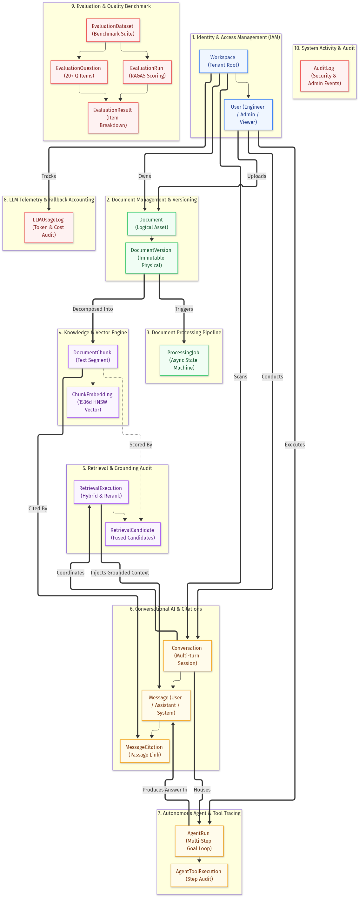

# Domain Model Specification
## Engineering Intelligence Platform
**Document Type:** Domain-Driven Design (DDD) Specification  
**Version:** 1.0  
**Phase:** Step 3 — Domain Modeling & Database Schema Design  
**Author:** Principal Database Architect & Domain Engineer  
**Status:** Approved for Implementation  

---

## Table of Contents
1. [Domain Modeling Overview & DDD Principles](#1-domain-modeling-overview--ddd-principles)
2. [Domain Boundaries & Bounded Contexts](#2-domain-boundaries--bounded-contexts)
3. [Resolution of Domain Business Decisions](#3-resolution-of-domain-business-decisions)
4. [Aggregate Roots, Entities & Value Objects](#4-aggregate-roots-entities--value-objects)
5. [Core Domain Specifications & Responsibilities](#5-core-domain-specifications--responsibilities)
6. [Business Rules & Domain Invariants](#6-business-rules--domain-invariants)
7. [Entity Lifecycles & State Transitions](#7-entity-lifecycles--state-transitions)
8. [Realistic Domain Walkthroughs](#8-realistic-domain-walkthroughs)
9. [Data Access & Security Boundaries](#9-data-access--security-boundaries)
10. [Requirement-to-Entity Traceability Matrix](#10-requirement-to-entity-traceability-matrix)

---

## 1. Domain Modeling Overview & DDD Principles

The **Engineering Intelligence Platform** provides factual, evidence-backed knowledge discovery and autonomous technical investigations across complex enterprise documentation.

To ensure long-term maintainability, strict security boundaries, and high developer velocity, the system is modeled using **Domain-Driven Design (DDD)** principles:
- **Ubiquitous Language:** Common terminology shared across engineering, product requirements, and database tables (e.g., *Document*, *DocumentVersion*, *Chunk*, *Embedding*, *RetrievalCandidate*, *Citation*, *AgentRun*, *ToolExecution*).
- **Bounded Contexts:** Clear functional separation between identity management, document ingestion, vector retrieval, conversational chat, agent autonomy, and evaluation.
- **Aggregate Roots:** Transactional consistency boundaries ensuring that child entities (such as chunks or citations) cannot exist in an orphaned or invalid state.
- **Zero-Trust Information Modeling:** Retrieved technical document content is structurally separated from system-level instructions and agent execution controls.

---

## 2. Domain Boundaries & Bounded Contexts

The system is partitioned into **ten cohesive domains**, mapped to specific bounded contexts:


*Figure 2.1: Domain Boundaries and Cross-Context Interaction Map (Editable source: `docs/database/DOMAIN_DIAGRAM.mmd`).*

```
+--------------------------------------------------------------------------------------------------+
|                                  BOUNDED CONTEXTS & DOMAINS                                      |
+-----+-----------------------------------+--------------------------------------------------------+
| #   | Bounded Context                   | Core Domain Responsibility                             |
+-----+-----------------------------------+--------------------------------------------------------+
| 1   | Identity & Access Management      | Workspace multi-tenancy, user authentication, RBAC     |
| 2   | Document Management & Versioning  | Logical technical document assets and immutable files  |
| 3   | Document Ingestion & Pipeline     | Asynchronous extraction, chunking, and job status      |
| 4   | Knowledge & Vector Engine         | Semantic text chunks and 1536d HNSW vector embeddings  |
| 5   | Retrieval & Grounding Audit       | Hybrid search (dense + BM25), RRF fusion, reranking    |
| 6   | Conversational AI & Citations     | Multi-turn sessions, context pruning, passage grounding|
| 7   | Autonomous Agent & Tool Tracing   | Multi-step reasoning loops and sandboxed tool calls    |
| 8   | LLM Telemetry & Fallback Audit    | Token usage, cost accounting, and provider failover    |
| 9   | Evaluation & Quality Measurement  | 20+ Q benchmark dataset, RAGAS scoring, pass/fail audit|
| 10  | System Observability & Activity   | Audit logging and administrative security records      |
+-----+-----------------------------------+--------------------------------------------------------+
```

---

## 3. Resolution of Domain Business Decisions

The Step 1 PRD highlighted two fundamental business decisions that shape entity relationships, ownership, and access boundaries.

### 3.1 Decision A: Document Access Model
- **Options Evaluated:**
  - *Option 1 (Private Only):* Documents strictly owned and queryable only by the individual uploader.
  - *Option 2 (Organization-Shared Only):* All documents communal within an organization.
  - *Option 3 (Hybrid Access Model):* Documents shared by default within a workspace, with optional private flags.
- **Trade-Off Analysis:** In engineering organizations, postmortems, architecture runbooks, and failure histories are inherently communal assets; a private-only model prevents collaborative SRE incident resolution. Conversely, enterprise compliance occasionally requires restricting draft security audits.
- **Recommended Architectural Choice:** **Workspace-Shared Default with Hybrid Schema Readiness** ([ADR-DB-001](file:///z:/enterprise-intelligence-platform/docs/database/decisions/ADR-DB-001-workspace-tenant-isolation-model.md)).
  - The `documents` table includes `workspace_id` (mandatory foreign key), `is_private: BOOLEAN DEFAULT FALSE`, and `owner_id: UUID REFERENCES users(id)`.
  - All standard engineering queries retrieve documents where `workspace_id = :current_workspace_id AND (is_private = FALSE OR owner_id = :current_user_id)`.
  - *Status:* **PROPOSED (Pending Product Owner confirmation)**.

### 3.2 Decision B: Knowledge Base Organization
- **Options Evaluated:**
  - *Option 1 (One Shared Knowledge Base):* All documents indexed into a single global vector space.
  - *Option 2 (Separate Physical Knowledge Bases):* Separate vector tables or database schemas per project.
  - *Option 3 (Single Unified Vector Space with Metadata Filtering):* Single vector table with project/subsystem tags.
- **Trade-Off Analysis:** Engineering failures frequently cross microservice boundaries (e.g., an API gateway latency incident is caused by database connection pool exhaustion in another service). Physical vector partitioning silos data and prevents cross-service root cause discovery.
- **Recommended Architectural Choice:** **Single Unified Vector Space with Metadata Filtering** ([ADR-008](file:///z:/enterprise-intelligence-platform/docs/architecture/decisions/ADR-008-document-access-and-knowledge-organization.md)).
  - All document chunks reside in `document_chunks` and `chunk_embeddings`.
  - Documents and chunks inherit structured metadata: `project`, `subsystem`, `environment` (e.g., `production`, `staging`), and `document_type` (e.g., `incident_report`, `architecture_spec`, `runbook`).
  - Broad cross-system investigations query the entire index; targeted queries apply atomic SQL metadata filters: `WHERE metadata->>'project' = 'auth-service'`.
  - *Status:* **PROPOSED (Pending Product Owner confirmation)**.

---

## 4. Aggregate Roots, Entities & Value Objects

In accordance with DDD patterns, entities are organized under designated **Aggregate Roots** that encapsulate business invariants:

```
[Workspace Aggregate Root]
  ├── User (Entity)
  └── AuditLog (Entity)

[Document Aggregate Root]
  ├── Document (Root Entity)
  ├── DocumentVersion (Entity - Immutable Snapshot)
  │     ├── DocumentChunk (Entity)
  │     │     └── ChunkEmbedding (Entity - Vector Value Representation)
  │     └── ProcessingJob (Entity - Pipeline Lifecycle)

[Conversation Aggregate Root]
  ├── Conversation (Root Entity)
  ├── Message (Entity)
  │     └── MessageCitation (Entity - Grounding Link)
  ├── RetrievalExecution (Entity)
  │     └── RetrievalCandidate (Value Object)
  └── AgentRun (Entity)
        └── AgentToolExecution (Entity)

[Evaluation Aggregate Root]
  ├── EvaluationDataset (Root Entity)
  ├── EvaluationQuestion (Entity)
  ├── EvaluationRun (Entity)
  └── EvaluationResult (Entity)

[LLM Usage Log (Independent Telemetry Entity)]
```

---

## 5. Core Domain Specifications & Responsibilities

### 5.1 Domain 1: Identity & Access Management (IAM)
- **`Workspace` (Aggregate Root):** Represents the top-level tenant organization or engineering division. Owns all documents, conversations, and usage metrics.
- **`User` (Entity):** Represents an authenticated engineer, SRE, or administrator.
  - *Responsibilities:* Manages credentials (bcrypt password hash), role assignment (`admin`, `engineer`, `viewer`), and active status.
  - *Ownership:* Belongs to exactly one `Workspace`.

### 5.2 Domain 2: Document Management & Versioning
- **`Document` (Aggregate Root):** Represents the logical technical document asset (e.g., `"Kubernetes Cluster Outage Runbook"`).
  - *Responsibilities:* Tracks logical identity, display title, file type, privacy status, uploader, active version pointer (`current_version_id`), and soft-delete state (`is_deleted`).
- **`DocumentVersion` (Entity):** Represents an immutable, point-in-time physical file snapshot ([ADR-DB-002](file:///z:/enterprise-intelligence-platform/docs/database/decisions/ADR-DB-002-immutable-document-versioning.md)).
  - *Responsibilities:* Stores raw file storage path (S3 key), file size, cryptographic checksum (SHA-256), version number, and structural metadata.
  - *Invariant:* Once created, a `DocumentVersion` is never updated. Updates create a new version record.

### 5.3 Domain 3: Document Ingestion & Pipeline
- **`ProcessingJob` (Entity):** Manages the asynchronous lifecycle of converting a raw document version into indexable vectors.
  - *Responsibilities:* Tracks stage (`EXTRACTION`, `CHUNKING`, `EMBEDDING`, `INDEXING`), execution status (`PENDING`, `PROCESSING`, `COMPLETED`, `FAILED`), retry attempts (max 3), error tracebacks, and Redis lock tokens.

### 5.4 Domain 4: Knowledge & Vector Engine
- **`DocumentChunk` (Entity):** An atomic, semantically coherent passage of extracted technical text (target: 512 tokens with 15% overlap).
  - *Responsibilities:* Stores raw text content, token count, page number, section heading, JSONB metadata, and a precomputed PostgreSQL `tsvector` generated column for sparse lexical BM25 search.
- **`ChunkEmbedding` (Entity):** The high-dimensional geometric vector representation of a chunk ([ADR-DB-003](file:///z:/enterprise-intelligence-platform/docs/database/decisions/ADR-DB-003-pgvector-chunk-embedding-storage.md)).
  - *Responsibilities:* Stores the 1536-dimensional floating-point array, embedding model identifier (`text-embedding-3-small`), and dimensionality.
  - *Index:* Indexed using HNSW with cosine distance (`vector_cosine_ops`).

### 5.5 Domain 5: Retrieval & Grounding Audit
- **`RetrievalExecution` (Entity):** Complete audit record of an evidence retrieval operation.
  - *Responsibilities:* Persists the raw prompt, rewritten query, applied metadata filters, candidate counts, and execution latency.
- **`RetrievalCandidate` (Value Object / Child Entity):** The scored candidate chunks evaluated during hybrid retrieval.
  - *Responsibilities:* Persists dense cosine similarity, BM25 rank, fused RRF score, cross-encoder neural rerank score, and context selection flag (`is_selected_for_context`).

### 5.6 Domain 6: Conversational AI & Citations
- **`Conversation` (Aggregate Root):** An ongoing technical investigation session between an engineer and the platform.
  - *Responsibilities:* Maintains session title, ownership, archive status, and an incremental semantic summary (`context_summary`) for conversational memory pruning.
- **`Message` (Entity):** A single conversational turn (`USER`, `ASSISTANT`, `SYSTEM`).
  - *Responsibilities:* Stores message body, LLM model used, and references to citations.
- **`MessageCitation` (Entity):** Direct verifiable link mapping a factual claim in an assistant response to an exact source chunk ([ADR-DB-002](file:///z:/enterprise-intelligence-platform/docs/database/decisions/ADR-DB-002-immutable-document-versioning.md)).
  - *Responsibilities:* Stores cited chunk ID, document version ID, relevance score, display marker (`[Doc 104, Chunk 3]`), and quoted text excerpt.

### 5.7 Domain 7: Autonomous Agent & Tool Tracing
- **`AgentRun` (Aggregate Root):** An autonomous multi-step technical investigation loop.
  - *Responsibilities:* Manages user goal, execution status (`RUNNING`, `COMPLETED`, `FAILED`, `MAX_STEPS_REACHED`), total step count, and final synthesized report.
- **`AgentToolExecution` (Entity):** A discrete tool invocation executed by the agent ([ADR-DB-005](file:///z:/enterprise-intelligence-platform/docs/database/decisions/ADR-DB-005-auditability-of-agent-and-retrieval-traces.md)).
  - *Responsibilities:* Stores tool name (`knowledge_base_search`, `document_analysis`, `structured_report_generation`), step sequence number, validated input arguments (JSONB), output result (JSONB), latency, and error trace.

### 5.8 Domain 8: LLM Telemetry & Fallback Audit
- **`LLMUsageLog` (Entity):** Fine-grained financial and performance accounting for every model call.
  - *Responsibilities:* Records provider (`anthropic`, `openai`), model, call type, prompt tokens, completion tokens, total tokens, calculated dollar cost, latency, and circuit-breaker failover events.

### 5.9 Domain 9: Evaluation & Quality Benchmarking
- **`EvaluationDataset` (Aggregate Root):** A versioned benchmark test suite.
- **`EvaluationQuestion` (Entity):** A benchmark test item containing prompt, expected answer, reference document IDs, and test category (`FACTUAL`, `SYNTHESIS`, `CONTRADICTION`, `NEGATIVE`). Supports a minimum of 20 questions.
- **`EvaluationRun` (Entity):** A quantitative benchmark execution scoring a specific model and retrieval pipeline.
- **`EvaluationResult` (Entity):** Itemized question-level metrics (faithfulness, precision, recall, relevance, latency, pass/fail).

### 5.10 Domain 10: System Observability & Activity
- **`AuditLog` (Entity):** Immutable audit trail recording administrative and security actions (user logins, document deletions, permission changes, export events).

---

## 6. Business Rules & Domain Invariants

```
+--------------------------------------------------------------------------------------------------+
|                                  CORE DOMAIN INVARIANTS                                          |
+--------------------------+-----------------------------------------------------------------------+
| Invariant Target         | Strict Domain Business Rule                                           |
+--------------------------+-----------------------------------------------------------------------+
| Document Deduplication   | A workspace cannot contain two active documents with identical        |
|                          | SHA-256 content hashes: UNIQUE(workspace_id, content_hash).           |
| Immutable Chunks         | Chunks belong to a specific DocumentVersion. Chunks are NEVER mutated |
|                          | in-place. If content changes, a new DocumentVersion must be created.  |
| Grounded Citations       | A MessageCitation must reference an existing DocumentChunk and        |
|                          | DocumentVersion. If a document is deleted, citations set chunk_id     |
|                          | to NULL but preserve the quoted text excerpt for historical fidelity. |
| Zero Orphaned Vectors    | When a DocumentVersion is purged, all associated DocumentChunks and   |
|                          | ChunkEmbeddings MUST be deleted atomically via ON DELETE CASCADE.     |
| Agent Step Ceiling       | An AgentRun MUST NOT exceed 5 iterations (max_steps = 5). Run enters  |
|                          | MAX_STEPS_REACHED state if the goal is not met within 5 steps.        |
| Memory Token Ceiling     | Conversation working context passed to an LLM MUST NOT exceed 1,000   |
|                          | tokens; older turns MUST be compressed into context_summary.          |
| Benchmark Integrity      | An EvaluationDataset MUST contain at least 20 active questions across |
|                          | all 4 categories (Factual, Synthesis, Contradiction, Negative).       |
+--------------------------+-----------------------------------------------------------------------+
```

---

## 7. Entity Lifecycles & State Transitions

### 7.1 Document Lifecycle State Machine
```
[User Upload] ──> PENDING ──> [Worker Pick] ──> PROCESSING
                                                    │
                   ┌────────────────────────────────┴────────────────────────────────┐
                   ▼                                                                 ▼
                INDEXED                                                           FAILED
                   │                                                                 │
    [User Deletes] │                                                 [User Retries]  │
                   ▼                                                                 ▼
              SOFT-DELETED (is_deleted = TRUE)                                    PENDING
                   │
  [Admin Purges]   │
                   ▼
              HARD-DELETED (ON DELETE CASCADE removes files, chunks, vectors)
```

### 7.2 Processing Job State Machine
```
PENDING ──> PROCESSING ──> COMPLETED (Status = 'COMPLETED')
                 │
                 └──> On Error ──> [Attempt < 3?]
                                         │
                         ┌───────────────┴───────────────┐
                         ▼                               ▼
                 Retry (PENDING)                 FAILED (Max attempts exceeded)
```

### 7.3 Agent Run State Machine
```
RUNNING ──> Step 1..5 ──> Success ──> COMPLETED
               │
               ├──> Tool Error Handled ──> Self-Correct on Next Step
               ├──> Unhandled Exception ──> FAILED
               └──> Step Counter == 5 ──> MAX_STEPS_REACHED (Graceful exit)
```

---

## 8. Realistic Domain Walkthroughs

### 8.1 Walkthrough 1: Document Upload & Asynchronous Ingestion
**Scenario:** SRE uploads `Postmortem_Incident_104.pdf` (Incident postmortem on Redis connection exhaustion).

```
1. USER: Engineer "Alex" (User ID: u-101, Workspace ID: ws-eng)
2. DOCUMENT CREATED:
   - id: doc-201
   - title: "Postmortem: Incident 104 Database Pool Outage"
   - filename: "Postmortem_Incident_104.pdf"
   - content_hash: "a4f89b...e72" (SHA-256)
   - status: "PENDING"
3. DOCUMENT_VERSION CREATED:
   - id: ver-301, document_id: doc-201, version_number: 1, file_size_bytes: 412850
4. PROCESSING_JOB CREATED:
   - id: job-401, document_version_id: ver-301, status: "PENDING", stage: "EXTRACTION"
5. WORKER PROCESSING:
   - Status updated to "PROCESSING"
   - PyMuPDF extracts 3 pages of text
   - Recursive chunker creates 6 chunks (Target: 512 tokens, 15% overlap)
6. DOCUMENT_CHUNKS & CHUNK_EMBEDDINGS PERSISTED:
   - Chunk 1: id: chk-501, chunk_index: 0, content: "Incident Summary: On Oct 24, at 14:22 UTC..."
   - Embedding 1: id: emb-601, chunk_id: chk-501, model: "text-embedding-3-small", vector: [0.0142, -0.0289, ...]
   - ... (Chunks 2 through 6 vectorized and inserted)
7. COMPLETION:
   - job-401 status updated to "COMPLETED"
   - doc-201 status updated to "INDEXED", current_version_id: ver-301
```

### 8.2 Walkthrough 2: Evidence-Based RAG Query & Citation Mapping
**Scenario:** Engineer asks: *"What was the root cause of the connection pool exhaustion in Incident 104?"*

```
1. CONVERSATION: id: conv-701, user_id: u-101, workspace_id: ws-eng
2. USER MESSAGE: id: msg-801, sender_type: "USER", content: "What was the root cause..."
3. RETRIEVAL EXECUTION: id: ret-901
   - raw_query: "What was the root cause..."
   - rewritten_query: "What was the reported root cause of the connection pool exhaustion in Incident 104?"
   - Hybrid Search:
     * Dense pgvector retrieves top 25 chunks (Cosine similarity)
     * Sparse BM25 retrieves top 25 chunks (tsvector match on "connection pool exhaustion")
   - RRF Fusion merges candidates into top 20
   - Cross-encoder reranks top 20 candidates
   - Retrieval Candidate 1: chunk chk-502 (Score: 0.94, is_selected: TRUE)
   - Retrieval Candidate 2: chunk chk-503 (Score: 0.88, is_selected: TRUE)
4. LLM SYNTHESIS & CITATION CREATION:
   - Fallback router invokes Claude 3.5 Sonnet with sanitized context blocks
   - LLM generates response: "The reported root cause was connection leak in the auth worker [Doc: doc-201, Chunk: chk-502]..."
5. ASSISTANT MESSAGE CREATED: id: msg-802, sender_type: "ASSISTANT", content: "The reported root cause..."
6. MESSAGE_CITATION CREATED:
   - id: cit-1001, message_id: msg-802, chunk_id: chk-502, document_version_id: ver-301,
     relevance_score: 0.94, citation_marker: "[1]", cited_text_snippet: "A leaked connection in auth_worker.py failed to close idle sockets..."
7. LLM USAGE LOG CREATED:
   - id: log-1101, provider: "anthropic", model: "claude-3-5-sonnet", prompt_tokens: 642, completion_tokens: 128, cost: $0.0038
```

### 8.3 Walkthrough 3: Autonomous Multi-Step Agent Investigation
**Scenario:** Lead SRE commands: *"Investigate database failure incidents across our services and generate an executive report."*

```
1. AGENT_RUN CREATED: id: run-1201, goal: "Investigate database failure incidents...", status: "RUNNING"
2. STEP 1 (Tool: knowledge_base_search):
   - Input: { "query": "database connection failure outage incident" }
   - Output: Returns matching chunks from doc-201 (Incident 104) and doc-205 (Incident 108)
   - AGENT_TOOL_EXECUTION recorded (step_number: 1, status: "SUCCESS", duration: 82ms)
3. STEP 2 (Tool: document_analysis):
   - Input: { "document_id": "doc-201", "focus_areas": ["root_cause", "symptoms", "mitigation"] }
   - Output: Extracted failure matrix: leak in auth_worker, pool resized from 20 to 100
   - AGENT_TOOL_EXECUTION recorded (step_number: 2, status: "SUCCESS", duration: 1420ms)
4. STEP 3 (Tool: structured_report_generation):
   - Input: { "title": "Database Outage Investigation", "findings": [...], "evidence": [...] }
   - Output: Formatted executive Markdown report with mitigation recommendations
   - AGENT_TOOL_EXECUTION recorded (step_number: 3, status: "SUCCESS", duration: 940ms)
5. RUN COMPLETION:
   - run-1201 status updated to "COMPLETED", total_steps: 3, duration_ms: 2840
   - Final report delivered to user interface with full tool audit timeline
```

---

## 9. Data Access & Security Boundaries

### 9.1 Tenant & Workspace Isolation
- Every query executed by the backend repository layer injects `workspace_id = :current_workspace_id`.
- Foreign key hierarchies cascade from `workspaces`, guaranteeing that no document, chunk, message, or log can exist without a tenant owner.

### 9.2 Row-Level Security (RLS) Strategy
While application-level parameterized filtering provides primary security, PostgreSQL **Row-Level Security (RLS)** is pre-architected as a defense-in-depth layer:
```sql
ALTER TABLE documents ENABLE ROW LEVEL SECURITY;

CREATE POLICY tenant_isolation_policy ON documents
FOR ALL
USING (workspace_id = NULLIF(current_setting('app.current_workspace_id', true), '')::uuid);
```
During request execution, the FastAPI auth dependency sets the session variable:
`SET LOCAL app.current_workspace_id = :workspace_id;`.

---

## 10. Requirement-to-Entity Traceability Matrix

| Functional Requirement | Assessment Source | Primary Supporting Entities |
| :--- | :--- | :--- |
| **Module A: Document Upload & Ingestion** | PDF Page 2 | `Document`, `DocumentVersion`, `ProcessingJob` |
| **Module A: Deduplication & Status** | PDF Page 2 | `Document.content_hash`, `ProcessingJob.status`, `ProcessingJob.lock_token` |
| **Module A: Chunking & Embeddings** | PDF Page 2 | `DocumentChunk`, `ChunkEmbedding` (vector(1536), HNSW) |
| **Module B: Vector & Hybrid Retrieval** | PDF Page 2 | `DocumentChunk.tsv_content`, `ChunkEmbedding.embedding`, `RetrievalExecution` |
| **Module B: Reranking & Citations** | PDF Page 2 | `RetrievalCandidate.rerank_score`, `MessageCitation` |
| **Module C: LLM Multi-Provider Fallback**| PDF Page 2 & 3 | `LLMUsageLog.provider`, `LLMUsageLog.fallback_occurred` |
| **Module D: AI Agent & 3 Tools** | PDF Page 2 | `AgentRun`, `AgentToolExecution` (Search, Analysis, Report tools) |
| **Module E: Conversational Memory** | PDF Page 2 | `Conversation`, `Conversation.context_summary`, `Message` |
| **Module F: Application Dashboard** | PDF Page 2 | `User`, `Document`, `Conversation`, `LLMUsageLog` |
| **Module G: AI Evaluation (20+ Qs)** | PDF Page 2 & 3 | `EvaluationDataset`, `EvaluationQuestion`, `EvaluationRun`, `EvaluationResult` |
| **Challenge 1: Model Fallback** | PDF Page 3 | `LLMUsageLog` (records failover event and reason) |
| **Challenge 2: Prompt Injection Defense**| PDF Page 3 | `DocumentChunk` (quarantined in XML delimiters) |
| **Challenge 6: Async Processing** | PDF Page 3 | `ProcessingJob` (asynchronous state machine in Redis/PostgreSQL) |
| **Challenge 7: Agent Reliability** | PDF Page 3 | `AgentRun.max_steps`, `AgentToolExecution.status` |

